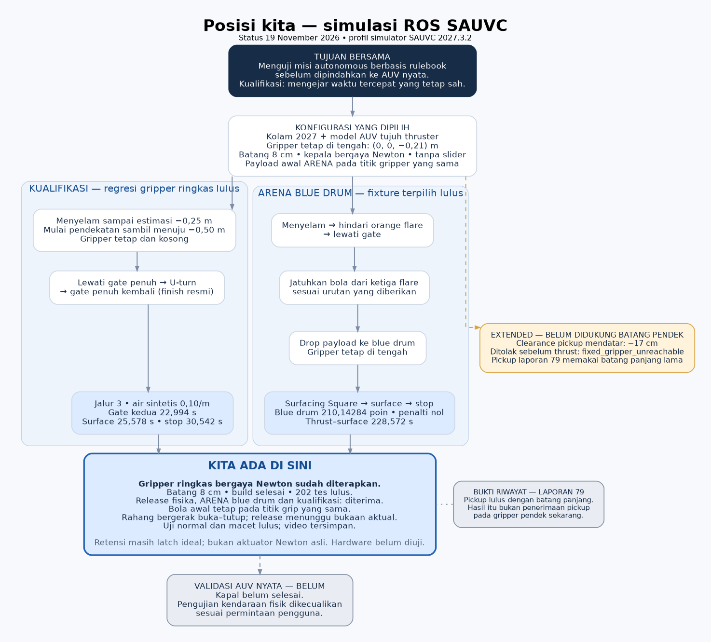

# Posisi kita — simulasi ROS SAUVC

Diperbarui **19 November 2026**. Ini ringkasan utama untuk mengikuti progres; laporan bernomor menyimpan rincian dan bukti historis.

**Tujuan:** menguji misi autonomous berdasarkan rulebook sebelum dipindahkan ke AUV nyata. Kualifikasi mengejar waktu tercepat dengan pelintasan yang sah; ARENA menyelesaikan tugas dan skor. Bukti saat ini masih pada simulator.

[Unduh PNG](doc/diagrams/status-simulasi-sauvc.png) · [SVG untuk diperbesar](doc/diagrams/status-simulasi-sauvc.svg) · [Sumber diagram](doc/diagrams/status-simulasi-sauvc.dot)

**Rulebook: halaman resmi dicek 19 November tetap 2027.3.2.** Pemeriksaan repo/arsip pada 18 November: versi publik tetap 2027.3.2 (30 Oktober), repo resmi identik dengan arsip; tidak ada migrasi aturan baru. [Bukti](doc/sources/rulebook-check-20261118.json).

## Revisi aktif — rahang bergerak, batang tetap 8 cm

Dua rahang kini memakai sendi revolute dengan controller posisi berbasis torsi. Payload awal dibawa dalam rahang tertutup; release menunggu bukaan aktual. Uji normal dan rahang macet lulus, termasuk render buka–lepas–tutup. Build dan **202 tes** lulus. Regresi dinamis diterima: blue drum **210,14284 poin / 228,572 s** tanpa penalti; kualifikasi jalur 3 mencatat gate kedua **22,994 s**, surface **25,578 s** dan stop **30,542 s**, keduanya stationary dan shutdown bersih. Retensi masih latch ideal dan pickup dasar drum tetap belum didukung. [Video](ros2_ws/evidence/gripper-joints-20261119/preview/jaw-motion.mp4) · [Laporan 81](plan/81-aktuasi-rahang-dan-release-terukur.md).

## Riwayat bentuk — laporan 80

Sesuai revisi pengguna, batang gripper dipendekkan menjadi **8 cm dari bawah hull ke atas telapak**. Kepala bergaya Newton memakai dua rahang capit berongga, gigi kecil, rumah aktuator hitam dan pin biru; posisi tetap di tengah, tanpa slider. Titik grip kini `(0, 0, −0,21) m`.

Build serta **201 tes lulus**. Release native dengan collision aktif, ARENA blue drum dan kualifikasi jalur 3 diterima; semua stop dan shutdown bersih. Blue drum **210,1426 poin / 228,580 s**, penalti nol. Kualifikasi: gate kedua **22,792 s**, surface **25,376 s**, stop **29,796 s**. [Laporan 80](plan/80-gripper-ringkas-bergaya-newton.md) · [Tampilan keseluruhan](ros2_ws/evidence/gripper-newton-20261119/initial.png) · [Detail telapak](ros2_ws/evidence/gripper-newton-20261119/empty/initial.png).

Pada laporan 80, rahang masih terbuka dan rigid. Aktuasi berikutnya ada pada laporan 81; keduanya tidak mengemulasikan mekanisme/performa Newton asli.

**Konsekuensi jangkauan:** clearance pickup dasar drum menjadi −17 cm pada pendekatan mendatar sekarang. Pengaman extended tetap menolak konfigurasi ini; keberhasilan pickup laporan 79 berlaku pada batang panjang sebelumnya.

## Riwayat gripper panjang — laporan 79

### Penerimaan versi panjang sebelumnya

Perubahan panjang **disetujui pengguna dan selesai diuji**: gripper di tengah `(0, 0, −0,40) m`, 30 cm di bawah hull, tanpa slider. Build selesai, **200 tes lulus**, dan tiga fixture 2027 diterima:

| Misi | Hasil terkini |
|---|---|
| Extended/pinger/pickup, Gazebo dan dua POV | **290,8026 poin**, thrust–surface **206,580 s**, penalti nol; bola yang sama dipertahankan sampai stop |
| ARENA blue drum | **210,15928 poin**, thrust–surface **228,024 s**, penalti nol |
| Kualifikasi jalur 3, air 0,10/m | Gate kedua **22,234 s**, surface **24,818 s**, stop **29,272 s** |

Semua stop dan shutdown bersih. Target kedalaman kualifikasi 2027 kini **−0,50 m** agar alat tetap berada dalam bukaan gate. Regresi pertama pada kedalaman lama gagal dan disimpan; pengulangan setelah koreksi lulus. ARENA memakai geometri/controller yang sama dengan revisi sekarang; patch kedalaman terakhir hanya mengenai kualifikasi.

Bola awal berada pada gripper. Retensi pickup terverifikasi pada 1.340 snapshot native, dengan jarak maksimum 4,71 cm terhadap titik grip, di bawah batas 7,5 cm. **Pickup selesai pada fixture simulator ini**; mekanisme jepit masih latch ideal dengan syarat collision, bukan pembuktian jari/servo nyata. Seluruh kondisi dan kendaraan fisik belum terbukti; pengujian fisik tetap dikecualikan.

[Laporan 79 dan bukti](plan/79-gripper-fixed-panjang-dan-pickup-selesai.md) · [Render alat dan bola awal](ros2_ws/evidence/gripper-fixed-040-20261119/initial.png) · [Video extended](ros2_ws/evidence/gripper-fixed-040-20261119/extended-1/pov.mp4) · [Cara running](ros2_ws/CARA-RUNNING.md).

## Riwayat sebelum penambahan panjang yang disetujui

## Status revisi fixed — 19 November 2026

Pilihan pengguna: **gripper pendek dan tetap, tanpa mekanisme memanjang**. Kode geometri kini memakai dudukan fixed pada `(0, 0, −0,18) m`; payload awal ARENA memakai titik yang sama. Pemeriksaan statis mengonfirmasi tidak ada joint slider dan extended ditolak dengan `fixed_gripper_unreachable` karena clearance pickup −20 cm.

**Kualifikasi sebelum penambahan panjang — optimasi 19 November:** pendekatan gate dimulai setelah estimasi kedalaman −0,25 m sambil melanjutkan penyelaman menuju −0,60 m. **198 tes lulus dan lima run controller baru diterima**, mencakup tiga jalur. Batas thrust/kecepatan, referee, U-turn dan pengaman tetap sama.

Pada tiga run nominal identik per revisi, median gate kedua **23,678 → 21,802 s**, surface **26,772 → 24,896 s**, stop **32,280 → 29,554 s**. Seluruh tiga baseline dan lima run baru stop/shutdown bersih. Ini hasil simulator pada fixture terpilih, bukan jaminan semua kondisi. [Laporan 78 dan grafik perbandingan](plan/78-optimasi-awal-kualifikasi-dinamis.md).

**ARENA:** dua layout blue drum lulus pada run 18 November: baseline **210,14872 poin / 228,376 s**, alternatif **210,37852 poin / 220,716 s**, penalti nol. Satu memiliki bukti Gazebo/dua POV. Controller ARENA tidak diubah pada optimasi ini dan run ARENA belum diulang. [Penerimaan fixed awal](plan/75-penerimaan-gripper-pendek-tetap.md) · [Fixture tambahan](plan/76-diagnosis-reach-fixed-dan-fixture-tambahan.md).

**Yang masih kurang:** pickup dasar drum dengan gripper pendek tetap belum didukung. Diagnosis box collision mendatar menunjukkan kekurangan clearance 20 cm; pencarian pose statis diskret pada enam posisi bola juga belum menemukan pose bebas benturan. Ini belum bukti untuk semua lintasan atau geometri fisik. Extended tetap ditolak sebelum thrust; penolakannya bukan kelulusan misi pickup. [Gambar diagnosis](ros2_ws/evidence/gripper-fixed-reach-20261118/reach.png). Validasi seluruh kondisi dan AUV nyata belum dilakukan; pengujian fisik tetap dikecualikan. [Cara running](ros2_ws/CARA-RUNNING.md).

**Diagnosis tambahan 19 November:** titik mesh asli juga berbenturan dengan lantai/dinding pada seluruh grid pose yang diuji di enam posisi bola. Contoh vertex asli berada sekitar 9,99 mm di dalam salah satu solid dinding drum. Ini menutup dugaan bahwa hasil grid sebelumnya semata-mata berasal dari ruang kosong dalam AABB; belum membuktikan seluruh kemungkinan lintasan. Diagnosis tersebut tidak mengubah geometri; optimasi dan misi kualifikasi sesudahnya dicatat pada laporan 78. [Laporan 77 dan gambar](plan/77-diagnosis-pickup-dengan-titik-mesh-asli.md).

Hasil tiga misi pada bagian riwayat di bawah adalah **versi slider 17 November**. Revisi fixed memiliki hasil 197 tes dan penerimaan sendiri pada laporan 75. Pengujian kendaraan fisik tetap dikecualikan.

## Riwayat sampai versi slider — 17 November 2026

- **Berfungsi dan punya bukti:** kualifikasi otomatis, ARENA blue drum/extended, kamera dan deteksi, dinamika tujuh thruster, estimator serta pengaman. Hasil berlaku pada skenario yang diuji.
- **Penerimaan versi slider:** gripper di tengah body, pendek saat membawa; bola awal terpasang pada carrier yang sama. Build, **197 tes** serta **tiga misi dinamis** (extended GUI/POV, blue drum dan kualifikasi) lulus dengan shutdown bersih. [Laporan 74](plan/74-gripper-tengah-pendek-dan-bola-awal.md).
- **Penerimaan sebelum perubahan gripper:** 13/13 pengulangan non-GUI lulus pada revisi antrean kamera: sembilan kualifikasi, arus/hold, prior posisi serta ARENA extended dan blue drum. Semua shutdown bersih; manifest 98 file cocok dengan laporan 72. Tiga GUI tanpa stale setelah gambar pertama serta respons kehilangan depth tetap merujuk bukti laporan 72.
- **Tes unit versi slider:** 197 lulus setelah revisi gripper. Hasil 195 tes dan replay pada laporan 70/72 merupakan bukti sebelumnya. Penerimaan misi revisi gripper juga lulus pada tiga fixture yang diuji.
- **Perbaikan kamera terbaru:** kehilangan pasangan RGB–depth pada antrean satu frame direproduksi. Masukan optik kini mempertahankan tiga capture; keluaran tetap satu frame terbaru. Tiga pengulangan GUI lulus tanpa stale setelah gambar pertama masuk. Ini belum jaminan semua beban komputer bebas jeda.
- **Kasus yang baru ditutup:** kualifikasi pada atenuasi sintetis 0,10/m yang sebelumnya `gate_lost` kini lulus di tiga jalur terpilih. Ini uji tambahan, bukan syarat rulebook. Perbaikannya memakai median warna pada fallback; kecepatan dan pengaman tetap.
- **Belum dibuktikan:** seluruh kondisi kolam dan misi pada AUV fisik. Kapal belum selesai. Refraksi, partikel dan gelombang bukan pekerjaan wajib proyek saat ini.

Bukti versi slider: [laporan 74](plan/74-gripper-tengah-pendek-dan-bola-awal.md) dan [verifikasi gripper](ros2_ws/evidence/gripper-centered-20261116/verification.json). Penerimaan 13 run sebelum perubahan gripper ada di [laporan 73](plan/73-konsistensi-setelah-perbaikan-antrean-kamera.md). Diagnosis kamera, tiga GUI dan depth fault ada di [laporan 72](plan/72-antrean-pasangan-rgb-depth-dan-pov.md). Riwayat demonstrasi dan batch 15 run ada pada [laporan 71](plan/71-demonstrasi-dan-konsistensi-revisi-optik.md). Perbaikan detektor ada pada [laporan 70](plan/70-kualifikasi-optik-010-dan-median-warna.md) dan [69](plan/69-rulebook-dan-perbaikan-halo-biru-arena.md). Acuan aktif 2027.3.2, terakhir dicek 18 November: [bukti rulebook](doc/sources/rulebook-check-20261118.json).

## Riwayat gripper dengan slider — digantikan pilihan fixed

Titik gripper kini `(0, 0, −0,18) m`: pusat bola hanya **8 cm di bawah hull**, dibanding 30 cm sebelumnya. Slider memanjang 22 cm hanya saat pickup dan retract lagi bersama bola; kualifikasi mengunci posisi pendek tanpa payload. Spawn payload, joint pemuatan dan alignment drop memakai titik yang sama. Kamera bawah bergeser 16 cm ke depan dan proyeksinya diselaraskan.

Release pertama gagal karena bukaan 34 mm menahan bola 40 mm. Bukaan kini 42 mm; probe release serta tiga misi final lulus dengan collision tetap aktif. Pose bola dan carrier berimpit pada 110 snapshot awal. Pickup mempertahankan bola melalui joint kontak sampai stop, dengan batas retensi 7,5 cm tetap. [Render inspeksi model baru](ros2_ws/evidence/gripper-centered-20261116/initial.png) · [Video POV extended](ros2_ws/evidence/gripper-centered-20261116/extended-2/pov.mp4).

Perubahan ini model simulator; ruang rod, servo dan mekanik nyata belum tervalidasi. Pengujian kendaraan fisik tetap dikecualikan. Hasil 13 run sebelumnya tetap riwayat sebelum perubahan gripper, bukan penerimaan ulang model terbaru.

## Penerimaan konsistensi sebelumnya

**13/13 run diterima pada source yang sama dengan laporan 72.** Matriks dan batas kelulusan sama dengan 13 kasus non-GUI laporan 71. Tidak ada perubahan source produksi pada tahap ini.

Sembilan kualifikasi: pelintasan kedua 23,632–24,674 detik, start–surface 26,726–27,768 detik, start–stop 31,322–32,598 detik simulasi. Hold arus 0,02 m/s selama sekitar 30 detik lulus dengan drift XY maksimum 4,95 mm; prior posisi ±10 cm juga lulus. ARENA extended mencapai 290,7396 poin dalam 208,680 detik dan blue drum 210,16066 poin dalam 227,978 detik; penalti keduanya nol.

Ini menutup pengulangan matriks yang sudah dipilih, bukan optimasi kecepatan atau jaminan seluruh kondisi. Tidak menambah tingkat uji baru secara otomatis. **Pengujian kendaraan fisik tetap dikecualikan.** [Laporan 73](plan/73-konsistensi-setelah-perbaikan-antrean-kamera.md).

## Diagnosis dan perbaikan antrean kamera sebelumnya

Antrean masukan RGB/depth dinaikkan dari satu menjadi tiga capture agar pasangan bertimestamp sama tidak hilang ketika pesan datang terpisah. Public raw tetap satu frame terbaru, tanpa perubahan batas stale. Pada tiga pengulangan GUI tidak ada stale setelah gambar pertama sampai DONE; sela raw bawah maksimum 0,363–0,470 detik, dibanding 1,112 detik pada reproduksi sebelum perubahan. [Rekaman terbaru](ros2_ws/evidence/camera-pairing-20261116/after-3/pov.mp4).

Kehilangan depth tetap menghasilkan abort aman tanpa replay. ARENA extended lulus: 290,7468 poin, penalti nol, thrust–surface 208,440 detik dan retensi bola sampai surface. Hasil ini menutup mekanisme antrean yang direproduksi; belum menjamin semua beban komputer atau penyebab stale historis. **Pengujian kendaraan fisik dikecualikan sesuai permintaan Anda.**

## Demonstrasi dan konsistensi sebelumnya

**Permintaan Anda sudah dikerjakan pada matriks yang disepakati:** demo terlihat dan seluruh 15 run diterima. Kasus arus 0,02 m/s dengan hold sekitar 30 detik mencatat drift maksimum 5,46 mm; kasus prior posisi ±10 cm juga lulus. Tiga ARENA termasuk demo: dua extended/pinger/pickup dan satu blue drum. Semua hasil tetap disimpan; ini bukti skenario terpilih, bukan seluruh kondisi.

Catatan penutupan: tiap run memiliki satu log `stale_sensors` sesudah `DONE`, dengan world dipause sebelum shutdown. Urutan ini konsisten dengan penghentian produsen sensor saat penutupan; tidak terjadi abort misi pada batch ini. Jeda POV bawah saat demo kualifikasi ditindaklanjuti secara terpisah pada laporan 72. Batch 15 run ini mendahului perubahan antrean.

Perbaikan kualifikasi 0,10/m pada tahap sebelumnya sudah selesai pada kasus yang diuji, dengan bukti di laporan 70.

## Langkah untuk menyamakan pemahaman

**Demonstrasi kualifikasi dan ARENA sudah dijalankan; Anda mengonfirmasi Gazebo serta kedua POV terlihat.** Cocokkan perilaku yang terlihat dengan alur pada diagram. Kedua POV direkam sebagai video untuk ditinjau ulang; konfirmasi terlihat tidak menggantikan pemeriksaan hasil misi. Perintah tersedia di [cara running](ros2_ws/CARA-RUNNING.md).

[Video kualifikasi](ros2_ws/evidence/demo-consistency-20261116/demo-qualification/pov.mp4) · [Video ARENA extended](ros2_ws/evidence/demo-consistency-20261116/demo-arena/pov.mp4). Video hanya merekam kamera simulasi, bukan desktop; bagian awal mencakup preflight. Bab waktu tersedia pada laporan 71.

Setiap sesi teknis berikutnya perlu menyebut satu fokus, hasil yang hendak dibuktikan, lalu hasil nyata dan batasnya. Ringkasan ini diperbarui bila ada bukti baru; pekerjaan opsional diberi label opsional. Persentase kemajuan tidak dipakai karena belum ada ukuran penyelesaian seluruh proyek yang disepakati.
