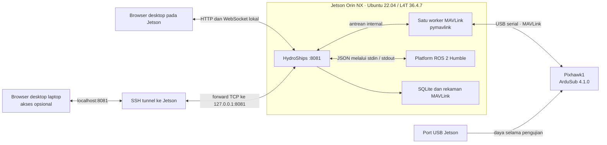
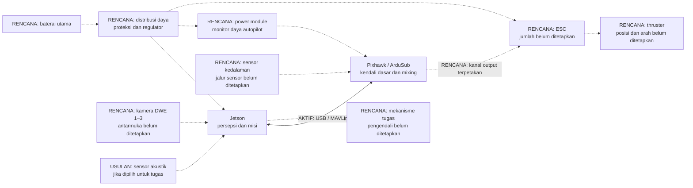
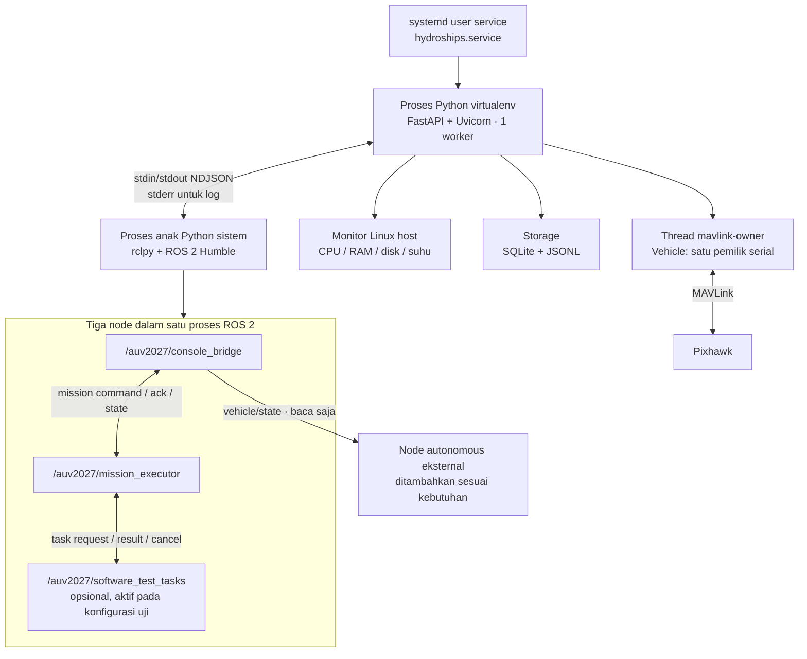

# Topologi keseluruhan sistem AUV2027 / HydroShips

**Versi dokumen:** 1.0 · **Tanggal:** 12 Oktober 2026 · **Bahasa:** Indonesia.

Dokumen ini menjadi pintu masuk bagi anggota tim Program, Elektrikal, Mekanik, dan penguji yang belum mengikuti pengembangan. Isinya menjelaskan perangkat yang digunakan, proses yang berjalan, jalur komunikasi, batas tanggung jawab, dan tempat menambahkan kemampuan autonomous.

Topologi mencerminkan source di repositori **AUV2027** serta hasil validasi Jetson dan Pixhawk. Status perangkat dan layanan diperiksa kembali saat dokumen dibuat. Detail konektor, pin, tegangan catu daya robot, dan kanal thruster yang belum dikonfirmasi diberi label **belum ditetapkan**.

## Daftar isi

1. [Gambaran sistem dan istilah](#1-gambaran-sistem-dan-istilah)
2. [Topologi perangkat yang sudah berjalan](#2-topologi-perangkat-yang-sudah-berjalan)
3. [Topologi robot lengkap yang dituju](#3-topologi-robot-lengkap-yang-dituju)
4. [Topologi proses aplikasi di Jetson](#4-topologi-proses-aplikasi-di-jetson)
5. [Jaringan, port, dan jalur komunikasi](#5-jaringan-port-dan-jalur-komunikasi)
6. [Aliran MAVLink dan data kendaraan](#6-aliran-mavlink-dan-data-kendaraan)
7. [Topologi ROS 2 dan kontrak modul](#7-topologi-ros-2-dan-kontrak-modul)
8. [Penyimpanan dan struktur source](#8-penyimpanan-dan-struktur-source)
9. [Startup, shutdown, dan gangguan](#9-startup-shutdown-dan-gangguan)
10. [Cara anggota tim memeriksa sistem](#10-cara-anggota-tim-memeriksa-sistem)
11. [Pembagian pekerjaan dan integrasi berikutnya](#11-pembagian-pekerjaan-dan-integrasi-berikutnya)
12. [Bukti dan pemeliharaan dokumen](#12-bukti-dan-pemeliharaan-dokumen)

## 1. Gambaran sistem dan istilah

**Jetson menjalankan HydroShips dan platform ROS 2; Pixhawk menjalankan firmware ArduSub.** Operator memakai browser desktop untuk melihat data, mengelola koneksi dan parameter, serta menguji urutan misi software. Jalur yang telah terbukti pada perangkat asli adalah **Pixhawk → USB/MAVLink → HydroShips → browser dan ROS 2**.

| Komponen / istilah | Peran dalam proyek |
| --- | --- |
| AUV2027 | Repositori utama; source aplikasi, package ROS 2, dokumentasi, dan deployment berada di sini |
| Jetson Orin NX | Komputer onboard untuk aplikasi, ROS 2, dan pengembangan persepsi/misi |
| Ubuntu / L4T | OS host Jetson; bukan diganti oleh HydroShips |
| HydroShips | Aplikasi mandiri Python/FastAPI + Vue/TypeScript yang mengacu pada fungsi antarmuka BlueOS |
| Pixhawk1 | Autopilot fisik yang terhubung ke Jetson melalui USB |
| ArduSub | Firmware autopilot; perangkat yang diuji memakai versi 4.1.0 |
| MAVLink | Protokol pertukaran identitas, telemetri, parameter, dan pesan status dengan autopilot |
| ROS 2 Humble | Lingkungan komunikasi antar-node untuk platform misi dan modul autonomous |
| DDS | Transport komunikasi topic ROS 2; bukan jalur langsung browser ke Pixhawk |
| Mission executor | Node yang mengatur tahap misi, hasil tugas, timeout, dan pembatalan |
| Driver tugas sintetis | Node pemberi hasil buatan untuk menguji executor; tidak menggerakkan kendaraan |
| Persepsi | Modul yang nantinya mengolah kamera/sensor untuk mengenali target |
| Adapter kendali | Modul yang nantinya menerjemahkan keputusan navigasi menjadi perintah autopilot; belum dibuat |

Label status dalam dokumen:

- **Aktif / tervalidasi:** tersedia dan pernah diperiksa pada sistem ini; bukti dirujuk pada bagian 12.
- **Implementasi uji software:** source berjalan, tetapi hasilnya belum membuktikan kemampuan robot fisik.
- **Rencana:** bagian dari arsitektur yang dituju; sambungan/modul belum terintegrasi.
- **Belum ditetapkan:** membutuhkan data atau keputusan tim sebelum dapat digambar sebagai wiring final.

## 2. Topologi perangkat yang sudah berjalan



Browser pada Jetson mengakses backend langsung. Laptop, jika digunakan, mengakses backend yang sama melalui SSH tunnel. Membuka lebih dari satu browser tetap memakai satu koneksi MAVLink milik backend.

| Bagian | Identitas / konfigurasi yang teramati | Status |
| --- | --- | --- |
| Jetson | Orin NX kelas RAM 16 GB, ARM64, Ubuntu 22.04.5, L4T 36.4.7 | Tervalidasi |
| OS dan aplikasi | HydroShips native sebagai user service systemd | Aktif |
| Pixhawk | USB descriptor dan STATUSTEXT menyebut Pixhawk1 | Tervalidasi |
| Firmware | ArduSub 4.1.0; STATUSTEXT `ArduSub V4.1.0 (f2af3c7e)` | Tervalidasi |
| Mode saat pemeriksaan | MANUAL, disarmed | Snapshot kondisi, dapat berubah |
| Port USB | `/dev/ttyACM0` | Nama kernel dapat berubah setelah pemasangan ulang |
| Alias stabil | `/dev/serial/by-id/usb-ArduPilot_Pixhawk1_230021000D51383236333932-if00` | Dipakai untuk pemilihan perangkat |
| Identitas USB | Serial `230021000D51383236333932`, VID 4617, PID 22337 | Dipakai untuk pemeriksaan identitas saat reconnect |
| Identitas MAVLink | Autopilot system 1 / component 1; UID firmware dilaporkan `0` | UID nol tidak dipakai sebagai identitas unik |
| Baud pilihan aplikasi | 115200 | Konfigurasi koneksi pada pengujian |
| Parameter | 893 / 893 terbaca lengkap | Hasil perangkat/firmware ini, bukan jumlah wajib semua Pixhawk |
| Frame firmware | `BLUEROV1` | Belum membuktikan susunan thruster fisik sesuai frame ini |
| Daya Pixhawk | Hanya USB Jetson, dikonfirmasi pengguna | Baterai/power module belum divalidasi |
| Daya Jetson | Jetson menyala; tipe sumber dan wiring catu daya robot belum dicatat | Belum ditetapkan |
| Kamera | Tim menyatakan memiliki 3 unit DWE | Model, koneksi, dan pemakaian belum divalidasi pada sesi ini |
| Sensor tekanan eksternal | Data `SCALED_PRESSURE2` belum terlihat pada snapshot | Keberadaan, sambungan, dan kalibrasi belum terkonfirmasi |
| Thruster / ESC / mekanisme tugas | Jumlah, tipe, kanal, arah, dan wiring belum dicatat | Belum ditetapkan |

**Makna pembacaan:** tegangan sekitar 0,7 V dan persentase baterai yang dilaporkan autopilot belum memvalidasi catu daya utama. `VFR_HUD.alt` ditampilkan sebagai altitude; kedalaman terhadap permukaan belum tersedia.

## 3. Topologi robot lengkap yang dituju

Diagram berikut menunjukkan rancangan fungsi. Semua sambungan putus-putus adalah **rencana**, bukan wiring yang sudah diuji. Diagram ini belum dapat dipakai sebagai referensi pinout pemasangan.



Pembagian fungsi yang dituju:

1. **Jetson:** menerima frame kamera/sensor, menghitung target dan estimasi navigasi, menjalankan urutan misi.
2. **Pixhawk–ArduSub:** menjalankan kendali dasar kendaraan dan mixing sesuai konfigurasi yang telah diverifikasi.
3. **Elektrikal:** menentukan catu daya Jetson/Pixhawk/ESC, distribusi, regulator, proteksi, konektor, serta jalur monitor daya.
4. **Mekanik:** menentukan posisi kamera, sensor, thruster, enclosure, dan mekanisme tugas.
5. **Adapter kendali di Jetson:** mengirim jenis perintah yang disepakati ke ArduSub melalui pemilik koneksi MAVLink yang sama. Jenis pesan, mode, frekuensi, dan respons kehilangan perintah belum dipilih.

Sebelum wiring final diterbitkan, tim perlu mengisi: model carrier Jetson, tegangan tiap jalur, konektor/pin, tipe power module, jalur sensor kedalaman, tipe koneksi setiap DWE, tabel kanal–ESC–thruster, arah putaran/vektor gaya, dan mekanisme penghentian fisik. Topologi software saat ini tidak menentukan nilai-nilai tersebut.

## 4. Topologi proses aplikasi di Jetson



- **Frontend** adalah hasil build Vue/TypeScript yang disajikan oleh backend dari `frontend/dist`. Browser tidak memakai CDN untuk aset aplikasi.
- **Backend web** memakai `hydroships/.venv/bin/python`; Node.js diperlukan saat build frontend, bukan sebagai server produksi.
- **Worker MAVLink** mengerjakan I/O serial, permintaan data, unduhan parameter, dan penulisan parameter terkonfirmasi. ROS dan browser memakai snapshot dari worker ini.
- **Proses ROS** memakai `/usr/bin/python3` dengan setup `/opt/ros/humble/setup.bash`, sehingga paket `rclpy` sistem tidak dicampur ke virtualenv web.
- **Console bridge** menghubungkan proses backend dengan topic DDS dan menemukan node/topic. Ia menerbitkan telemetri kendaraan serta meneruskan perintah misi software.
- **Mission executor** mengatur urutan tahap. Status sukses berasal dari hasil modul tugas yang sesuai, bukan dari penilaian gambar/kendaraan oleh executor.
- **Driver sintetis** mengembalikan hasil buatan setelah sekitar 1,5 detik untuk skenario berhasil/gagal. Skenario tidak merespons menguji timeout.

HydroShips mandiri merupakan jalur utama integrasi Pixhawk saat ini. Direktori `deploy/blueos/` menyimpan eksperimen BlueOS container sebelumnya pada port 8080. BlueOS tersebut bukan dependensi runtime HydroShips port 8081; status container lama harus diperiksa tersendiri bila hendak digunakan. Source proyek KKI dan workspace AGV lokal juga bukan layanan yang perlu dijalankan untuk platform ini.

## 5. Jaringan, port, dan jalur komunikasi

| Jalur / endpoint | Protokol dan isi | Pengguna / cakupan |
| --- | --- | --- |
| `127.0.0.1:8081` | HTTP, frontend dan REST API | HydroShips utama, loopback Jetson |
| `/api/live` pada port 8081 | WebSocket JSON, snapshot kendaraan/host/events sekitar 2 Hz | Dashboard dan halaman pemantauan |
| `/api/autonomy` pada port 8081 | HTTP JSON, polling sekitar 1 Hz saat halaman Autonomous dibuka | Runtime, rencana, kendaraan, graph, dan riwayat |
| Alias USB Pixhawk | Serial MAVLink | Hanya worker MAVLink HydroShips |
| Backend ↔ proses ROS | Pipe stdin/stdout JSON per baris, stderr log | Komunikasi lokal antarproses, tidak membuka port web baru |
| ROS 2 domain 0 | DDS, topic namespace `/auv2027` | Runtime utama dan modul pada domain yang sama |
| `127.0.0.1:8083`, ROS domain 77 | Layanan uji terpisah | Tes browser; dihentikan setelah pengujian |
| ROS domain 78 | DDS terisolasi | Tes integrasi backend/ROS 2 |
| `127.0.0.1:14560` | Listener UDP MAVLink, bila dipilih | ArduSub SITL; opsional, bukan koneksi Pixhawk USB |
| `127.0.0.1:8080` | HTTP eksperimen BlueOS sebelumnya | Profil deployment terpisah, bukan API HydroShips mandiri |

Untuk operator di laptop:

```bash
ssh -L 8081:127.0.0.1:8081 aero@ALAMAT_JETSON
```

Buka `http://127.0.0.1:8081` pada laptop setelah tunnel aktif. `ALAMAT_JETSON` harus diganti dengan IP/hostname Jetson yang dapat dijangkau; IP statis, jenis jaringan, dan tether robot belum ditetapkan. Untuk akses langsung pada Jetson, tunnel tidak diperlukan.

Backend default membatasi host/origin dan mutasi API memakai header `X-Hydroships-Client: dashboard`. Ini pengamanan permintaan browser; aplikasi belum mempunyai akun/operator login. Arsitektur akses yang terdokumentasi adalah localhost atau SSH tunnel.

## 6. Aliran MAVLink dan data kendaraan

### 6.1 Dari Pixhawk ke operator dan ROS 2

1. Operator memilih port serial melalui halaman **Koneksi**.
2. Worker membuka perangkat yang terdaftar dan memeriksa fingerprint USB. Identitas target ditentukan dari heartbeat autopilot.
3. Pada target yang dipilih, worker meminta `AUTOPILOT_VERSION`, stream data dengan permintaan 10 Hz, dan seluruh parameter. Frekuensi permintaan stream tidak menjamin semua jenis pesan dikirim pada 10 Hz.
4. Pesan diterima, disaring menurut system/component target, diolah menjadi field snapshot, dan direkam sebagai JSONL.
5. Snapshot dikirim ke browser melalui WebSocket. Backend juga meneruskan snapshot ke console bridge, lalu `/auv2027/vehicle/state` sekitar 2 Hz.
6. Node autonomous dapat berlangganan topic kendaraan untuk memakai data tanpa membuka koneksi serial sendiri.

| Pesan MAVLink | Data yang digunakan | Catatan |
| --- | --- | --- |
| `HEARTBEAT` | Identitas target, armed, mode, usia koneksi | Tidak membuktikan kesiapan sensor/aktuator |
| `AUTOPILOT_VERSION` | Firmware, capabilities, UID | Target utama diuji system 1/component 1 |
| `ATTITUDE` | Roll, pitch, yaw | Radian dikonversi ke derajat; yaw ditampilkan 0–360° |
| `SYS_STATUS` | Tegangan, arus, persentase baterai | Nilai tidak tersedia protokol dilewati; angka yang ada tetap perlu validasi kalibrasi |
| `VFR_HUD` | Heading, altitude | Altitude tidak diubah menjadi kedalaman |
| `SCALED_PRESSURE2` | Tekanan eksternal dan suhu | Hanya tersedia bila pesan benar-benar diterima |
| `PARAM_VALUE` | Nama, nilai, tipe, indeks, jumlah parameter | Indeks hilang diminta ulang untuk melengkapi unduhan |
| `STATUSTEXT` | Pesan/status autopilot | Masuk riwayat kejadian |

ID pengirim HydroShips pada source saat ini adalah **system 250 / component 191**. ID ini berbeda dari autopilot target. Pesan dari target lain tidak boleh menimpa snapshot kendaraan terpilih.

### 6.2 Dari operator ke Pixhawk

Jalur tulis yang sudah ada adalah perubahan **satu parameter**, melalui `PUT /api/parameters/{name}` → antrean worker → `PARAM_SET` → konfirmasi `PARAM_VALUE`.

Perubahan memerlukan ArduSub teridentifikasi, koneksi/heartbeat baru, disarmed, daftar parameter lengkap, sesi yang cocok, dan nilai lama yang masih sesuai. Respons nilai harus cocok sebelum operasi dinyatakan terkonfirmasi. Timeout tidak otomatis mengirim ulang; nilai perlu dibaca ulang karena perangkat mungkin telah menerapkannya.

Permintaan identitas, stream, dan unduhan parameter juga dikirim ke Pixhawk. Relay kendaraan ke ROS sendiri hanya menerbitkan data. Jalur perintah arm/disarm, ganti mode, setpoint gerak, atau aktuator dari aplikasi belum tersedia.

### 6.3 API menurut fungsi

| Fungsi | Endpoint utama |
| --- | --- |
| Kesehatan backend / snapshot | `GET /api/health`, `GET /api/state` |
| Port / koneksi | `GET /api/ports`, `POST` dan `DELETE /api/connection` |
| Identitas aplikasi | `GET` dan `PUT /api/settings` |
| Parameter | `GET /api/parameters`, `POST /api/parameters/refresh`, `GET /api/parameters/export`, `PUT /api/parameters/{name}` |
| Kejadian / rekaman | `GET /api/events`, `GET /api/logs`, `GET /api/logs/{name}` |
| Status autonomous | `GET /api/autonomy` |
| Rencana / runtime | `PUT /api/autonomy/plan`, `POST` dan `DELETE /api/autonomy/runtime` |
| Eksekusi software | `POST /api/autonomy/run`, `POST /api/autonomy/abort` |
| Laporan misi | `GET /api/autonomy/runs/{identifier}` |

`/api/health` memeriksa worker MAVLink masih hidup. Respons sehat dari endpoint ini belum berarti Pixhawk connected, runtime ROS siap, atau robot siap bergerak; keadaan itu diperiksa pada snapshot masing-masing.

## 7. Topologi ROS 2 dan kontrak modul

### 7.1 Peta topic

Topic berikut bertipe **`std_msgs/msg/String` dengan object JSON**. QoS topic `/auv2027` adalah reliable/volatile; depth 10 untuk misi/tugas dan depth 1 untuk kendaraan.

| Topic | Publisher saat ini | Subscriber / pemakai | Fungsi |
| --- | --- | --- | --- |
| `/auv2027/mission/command` | `console_bridge` | `mission_executor` | Start/abort misi software |
| `/auv2027/mission/ack` | `mission_executor` | `console_bridge` | Konfirmasi penerimaan/penolakan `command_id` |
| `/auv2027/mission/state` | `mission_executor` | `console_bridge`, observer | Snapshot progres misi |
| `/auv2027/tasks/request` | `mission_executor` | Driver sintetis atau modul tugas eksternal | Permintaan satu tahap |
| `/auv2027/tasks/result` | Driver sintetis atau modul tugas eksternal | `mission_executor` | Hasil selesai/gagal untuk tahap yang cocok |
| `/auv2027/tasks/cancel` | `mission_executor` | Driver/modul tugas | Penghentian/pembersihan request aktif |
| `/auv2027/vehicle/state` | `console_bridge` | Observer dan modul autonomous | Telemetri kendaraan baca saja |
| `/hydroships/mission/state` | Sistem ROV KKI jika dijalankan terpisah | `console_bridge` | Kompatibilitas pengamatan legacy; best-effort, baca saja |

`/parameter_events` dan `/rosout` merupakan topic pendukung ROS. Kemunculan topic legacy pada graph bisa disebabkan subscription bridge sendiri; tidak membuktikan sistem ROV lama sedang menerbitkan data.

### 7.2 Payload kendaraan dan umur data

| Field | Makna |
| --- | --- |
| `schema_version` | Versi kontrak, saat ini `1` |
| `captured_at` | Waktu snapshot backend, Unix detik |
| `session` | ID sesi koneksi; berubah saat sesi dibersihkan |
| `status` | Connected, connecting, reconnecting, disconnected, atau stale pada relay |
| `connection` | Jenis serial/demo/UDP, endpoint, dan metadata koneksi yang tersedia |
| `identity` | Identitas, firmware, mode, armed, dan informasi autopilot |
| `heartbeat_age` | Usia heartbeat, ditambah waktu frame berada di bridge |
| `fields` | Field bernama; setiap field membawa `value`, `unit`, `source`, `ts`, `age`, `stale` |
| `parameters` | Ringkasan jumlah/kelengkapan/operasi tulis; bukan seluruh daftar parameter |
| `received` | Penghitung pesan MAVLink dari target yang dipilih |
| `relay_age` | Usia frame sejak diterima bridge, menggunakan waktu monotonic |

Input bridge lebih tua dari **2 detik** ditandai stale. Heartbeat berusia **≥3 detik** tidak dianggap connected. Field berusia **>3 detik**, sebelumnya stale, atau koneksi tidak connected juga ditandai stale. Disconnect normal mengirim sesi baru dan field kosong.

Subscriber harus memeriksa `connection.kind`, `session`, status, dan stale, serta memasang timeout penerimaan lokal. Bila publisher berhenti seluruhnya, tidak ada pesan baru untuk menyatakan stale. QoS volatile menghindari pengiriman snapshot lama tersimpan kepada subscriber baru.

### 7.3 Alur satu misi software

```mermaid
sequenceDiagram
    participant UI as Browser
    participant API as Backend + SQLite
    participant B as Console bridge
    participant E as Mission executor
    participant T as Driver / modul tugas
    UI->>API: Simpan rencana + revision
    API-->>UI: Revision baru
    UI->>API: Jalankan uji software
    API->>B: Start + command_id + run_id
    B->>E: mission/command
    E->>T: tasks/request + request_id
    E-->>B: mission/ack + mission/state
    B-->>API: ACK dan snapshot
    API-->>UI: Start diterima
    T-->>E: tasks/result dengan ID cocok
    E-->>B: Progres; lanjut tahap / selesai
    B-->>API: Snapshot eksekusi
    API->>API: Simpan transisi dan riwayat
    UI->>API: Poll status / unduh JSON
    API-->>UI: Hasil dan jejak eksekusi
```

Contoh request tahap (placeholder UUID diganti ID dari runtime):

```json
{"run_id":"UUID-eksekusi","request_id":"UUID-tahap","step_index":0,"task":"navigation","timeout":15,"mode":"software_test","scenario":"success"}
```

Contoh hasil modul:

```json
{"run_id":"UUID-eksekusi","request_id":"UUID-tahap","status":"succeeded"}
```

Modul juga boleh mengembalikan `status: "failed"` dengan `detail`. Hasil tahap lama, ID yang berbeda, duplikat, atau hasil pada/setelah deadline tidak menyelesaikan tahap berikutnya. Pembatalan membawa pasangan `run_id` dan `request_id` yang harus dihentikan/dibersihkan.

Slot tugas saat ini: `navigation`, `acquisition`, `reacquisition`, dan `localization`. Slot tersebut menamai pekerjaan; algoritme gerbang, target, akustik, atau navigasinya belum diimplementasikan. Makna tugas dan aturan lomba harus diperbarui berdasarkan edisi aturan yang digunakan tim.

Rencana memiliki **1–16 tahap**, timeout tahap **1–600 detik**, batas total **1–1800 detik**, dan nama maksimal **80 karakter**. Batas tersebut merupakan validasi aplikasi, bukan ketentuan kompetisi. Revision melindungi rencana dari penimpaan antarbrowser. Backend menunggu ACK maksimal sekitar 5 detik dan tidak mengirim ulang otomatis jika konfirmasi hilang.

### 7.4 Tempat memasukkan kode autonomous

1. Buat node/package modul di workspace ROS 2 dalam repositori AUV2027.
2. Untuk input, subscribe `/auv2027/vehicle/state`; tambahkan jalur kamera setelah integrasinya tersedia.
3. Untuk pekerjaan tahap, subscribe `tasks/request` dan `tasks/cancel`; publish `tasks/result` memakai ID yang diterima.
4. Matikan driver sintetis dengan `HYDROSHIPS_ROS_TEST_TASKS=0` dan restart runtime melalui layanan setelah konfigurasi diubah.
5. Gunakan domain DDS yang sama dengan platform. Modul eksternal dikelola terpisah; backend saat ini hanya mengawasi proses platform ROS miliknya.
6. Uji modul pada rekaman/simulasi, termasuk target hilang, timeout, pembatalan, dan hilangnya data. Setelah adapter kendali dibuat dan divalidasi, integrasikan jalur kendaraan fisik.

Jangan menjalankan driver sintetis bersama modul tugas nyata untuk menilai keberhasilan tugas: respons sintetis bisa menyelesaikan tahap lebih dulu. Tanpa driver sintetis dan tanpa modul yang merespons, tahap akan gagal karena timeout.

## 8. Penyimpanan dan struktur source

```text
AUV2027/
├── doc/                                   # Topologi ini dan riset
├── plan/                                  # Keputusan, pelaksanaan, bukti validasi
├── hydroships/
│   ├── backend/hydroships/
│   │   ├── app.py                         # API, lifespan, WebSocket
│   │   ├── vehicle.py                     # Worker tunggal MAVLink
│   │   ├── autonomy.py                    # Supervisi ROS dan relay kendaraan
│   │   ├── storage.py                     # SQLite, kejadian, rotasi JSONL
│   │   ├── system.py                      # Metrik Linux/Jetson
│   │   └── simulator.py                   # Kendaraan MAVLink demo
│   ├── frontend/src/
│   │   ├── App.vue                        # Navigasi dan halaman utama
│   │   ├── AutonomyPanel.vue              # Rencana, runtime, kendaraan, riwayat
│   │   ├── state.ts                       # REST client dan WebSocket
│   │   └── ParameterComparison.vue        # Pembanding cadangan di browser
│   ├── ros2_ws/src/auv2027_autonomy/
│   │   └── auv2027_autonomy/
│   │       ├── core.py                    # Mesin urutan misi tanpa I/O
│   │       ├── ros.py                     # Node ROS, driver uji, console bridge
│   │       └── telemetry.py               # Umur dan stale pada relay
│   ├── scripts/                           # Instalasi service dan pemeriksaan
│   ├── tests/                             # Pengujian backend/ROS
│   ├── .data/                             # Runtime lokal, diabaikan Git
│   └── evidence/                          # Bukti/cadangan lokal, diabaikan sesuai pola Git
└── deploy/blueos/                          # Profil eksperimen BlueOS sebelumnya
```

| Data | Lokasi / batas | Cara mempertahankan |
| --- | --- | --- |
| Nama, pilihan koneksi, rencana misi | `.data/hydroships.sqlite3`, tabel `settings` | Backup direktori data saat layanan berhenti |
| Kejadian aplikasi | SQLite, tabel `events`, maksimal 10.000 | Ekspor/arsip sebelum rotasi |
| Riwayat misi | SQLite, tabel `mission_runs`, maksimal 100 | Browser menampilkan 20 terbaru; unduh laporan JSON |
| Pesan MAVLink diterima | `.data/telemetry/*.jsonl`, maksimal 8 berkas × 8 MiB | Unduh/arsip sebelum rotasi |
| Cache parameter / snapshot kendaraan | Memori worker | Ekspor `.params` ketika daftar lengkap; cache dibersihkan saat sesi berubah |
| Frame terakhir relay ROS | Memori bridge | Bukan database; gunakan freshness dan log eksperimen |
| Cadangan dan hasil tes | `hydroships/evidence/` | Salin ke arsip tim; berkas JSON/PNG/.params lokal diabaikan Git |
| Aset frontend | `frontend/dist/` | Hasil build, dapat dibuat ulang dari source |

Lokasi default data adalah `/home/aero/AUV2027/hydroships/.data`; `HYDROSHIPS_DATA_DIR` dapat mengubahnya. SQLite memakai WAL. Backup konsisten dilakukan setelah layanan berhenti; salin direktori lengkap, termasuk berkas WAL bila masih ada.

Source kode harus dibagikan melalui repositori AUV2027 yang sama. Bukti yang diabaikan Git perlu dibagikan melalui arsip terpisah jika anggota tim lain perlu menilai hasil pengujian.

## 9. Startup, shutdown, dan gangguan

### 9.1 Konfigurasi utama

| Variabel | Default / konfigurasi | Pengaruh |
| --- | --- | --- |
| `HYDROSHIPS_HOST` | `127.0.0.1` | Alamat bind web |
| `HYDROSHIPS_PORT` | `8081` | Port web |
| `HYDROSHIPS_ALLOWED_HOSTS` | `127.0.0.1,localhost` | Host yang diterima backend |
| `HYDROSHIPS_DATA_DIR` | Direktori `.data` aplikasi | Penyimpanan runtime |
| `HYDROSHIPS_ROS_ENABLED` | Default aplikasi `0`; unit service memasang `1` | Menyalakan proses ROS saat startup |
| `HYDROSHIPS_ROS_SETUP` | `/opt/ros/humble/setup.bash` | Setup ROS administrator |
| `HYDROSHIPS_ROS_DOMAIN_ID` | `0`, dibatasi 0–232 | Domain DDS platform |
| `HYDROSHIPS_ROS_TEST_TASKS` | `1`; `0` untuk modul eksternal | Mengaktifkan/mematikan driver sintetis |

Unit service terpasang di `~/.config/systemd/user/hydroships.service`. Ia menjalankan satu worker Uvicorn, menghapus `PYTHONPATH` warisan, dan restart saat proses gagal. Lock pada direktori data mencegah dua aplikasi memakai data yang sama secara bersamaan. Status user service saat boot bergantung konfigurasi systemd/lingering host; bukti reboot perlu dicatat terpisah.

### 9.2 Urutan startup

1. Service membuka lock dan database, membuat worker MAVLink serta monitor host.
2. Jika ROS diaktifkan, backend memulai proses anak dan menunggu status executor.
3. Browser mengambil aset lokal dan snapshot, kemudian membuka WebSocket.
4. Operator menghubungkan Pixhawk melalui halaman Koneksi. Pilihan terakhir tersimpan, tetapi perangkat tidak otomatis dibuka setelah startup aplikasi.
5. Parameter diunduh setelah heartbeat target diterima; Autonomous menampilkan runtime dan relay kendaraan.
6. Misi tetap menunggu perintah operator. Startup/restart tidak menjalankan atau melanjutkan misi otomatis.

### 9.3 Respons gangguan

| Gangguan | Perilaku yang diimplementasikan | Implikasi bagi pengembang/operator |
| --- | --- | --- |
| Browser ditutup / WebSocket putus | Browser mencoba menyambung ulang; proses onboard tidak bergantung keberadaan browser | Tutup tab bukan perintah abort |
| Heartbeat hilang >3 detik | Koneksi dibersihkan, sesi/cache berubah; alias stabil dapat dicoba kembali | Periksa sesi baru, jangan memakai cache lama |
| USB hilang / fingerprint berubah | Worker menolak perangkat berbeda atau menunggu perangkat yang cocok | Identitas USB menjadi dasar reconnect |
| Parameter timeout | Operasi tidak terkonfirmasi; tidak dikirim ulang otomatis | Baca nilai perangkat sebelum mengulang |
| Feed telemetry backend terhenti | Bridge menandai stale setelah batas usia | Subscriber memeriksa usia dan timeout lokal |
| Proses ROS berhenti | Backend menandai misi aktif interrupted; startup runtime berikutnya tidak resume | Pemulihan runtime berbeda dari pemulihan kontrol robot |
| Batas misi/tahap terlampaui | Executor mengakhiri misi failed dan menerbitkan cancel | Modul tugas harus mematuhi cancel serta deadline lokal |
| Backend berhenti | Worker serial ditutup, proses ROS anak dihentikan | Status kendaraan fisik tetap tanggung jawab autopilot dan pengendali yang kelak dibuat |

Runtime ROS siap, heartbeat ada, parameter lengkap, atau hasil uji software sukses merupakan status subsistem masing-masing. Pemeriksaan kesiapan robot fisik belum diimplementasikan.

## 10. Cara anggota tim memeriksa sistem

Perintah berikut dapat dijalankan dari terminal Jetson untuk melihat status tanpa mengubah kendaraan:

```bash
cd /home/aero/AUV2027
systemctl --user status hydroships.service
journalctl --user -u hydroships.service -n 50 --no-pager
curl -fsS http://127.0.0.1:8081/api/health
curl -fsS http://127.0.0.1:8081/api/state
curl -fsS http://127.0.0.1:8081/api/autonomy
ls -l /dev/serial/by-id/
```

Untuk pemeriksaan ROS, gunakan setup dan domain yang sama dengan runtime utama:

```bash
source /opt/ros/humble/setup.bash
export ROS_DOMAIN_ID=0
ros2 node list
ros2 topic list
ros2 topic echo /auv2027/vehicle/state std_msgs/msg/String
```

Daftar node/topic menunjukkan graph, sedangkan `echo` menunjukkan payload yang benar-benar diterima. Beri waktu discovery dan hentikan `echo` dengan Ctrl+C setelah pemeriksaan. Jangan menjalankan executor kedua pada domain yang sama dengan service.

Bukti uji baca saja perangkat asli, setelah serial terhubung dan parameter lengkap:

```bash
cd /home/aero/AUV2027/hydroships
env -u PYTHONPATH .venv/bin/python scripts/check-pixhawk.py --seconds 60
ROS_DOMAIN_ID=0 /usr/bin/python3 scripts/check-ros-vehicle.py --source serial --output evidence/pixhawk/ros-vehicle.json
env -u PYTHONPATH .venv/bin/python scripts/check-browser.py --read-only --desktop-only --output evidence/pixhawk/browser
```

Tes backend/ROS memakai data sementara dan domain 78:

```bash
env -u PYTHONPATH HYDROSHIPS_TEST_ROS=1 .venv/bin/python -m pytest -q
```

Pemeriksaan browser Autonomous yang menjalankan misi software memakai layanan uji port 8083/domain 77, bukan layanan kendaraan utama. Setup lengkap ada di [panduan ROS 2](../hydroships/ros2_ws/README.md). Langkah instalasi/build, aktivasi service, dan backup tersedia di [README HydroShips](../hydroships/README.md).

## 11. Pembagian pekerjaan dan integrasi berikutnya

| Bidang | Tanggung jawab / hasil yang perlu diserahkan |
| --- | --- |
| Program platform | Menjaga API, pemilik MAVLink tunggal, ROS bridge, logging, startup, dan pemulihan |
| Program kamera/persepsi | Identitas kamera, preview/rekaman, FPS/latensi, dataset, hasil deteksi target, confidence, dan kondisi target hilang |
| Program navigasi/kendali | Acuan koordinat/unit, estimasi arah/kedalaman, kontrak setpoint, adapter autopilot, timeout dan pembatalan |
| Elektrikal | Diagram daya, proteksi, regulator, konektor/pin, ESC, kanal output, sensor, monitor daya, penghentian fisik |
| Mekanik | Posisi/arah thruster, ruang pandang kamera, pemasangan sensor, enclosure, dan mekanisme tugas |
| Pengujian | Versi source/firmware, konfigurasi, kondisi perangkat, rekaman, hasil terukur, kegagalan, dan bukti yang dapat diulang |

Urutan pengembangan yang disarankan berdasarkan keadaan sekarang:

1. Lengkapi tabel wiring dan pemetaan aktuator bersama Elektrikal/Mekanik.
2. Integrasikan satu kamera, ukur FPS/latensi, lalu siapkan rekaman uji gerbang.
3. Buat node persepsi gerbang yang memakai rekaman/kamera dan melaporkan target serta confidence.
4. Validasi data/kalibrasi kedalaman dan arah serta acuan koordinat yang akan dipakai navigasi.
5. Buat modul navigasi dan adapter kendali, uji terlebih dahulu pada simulator/rekaman sesuai fungsi.
6. Integrasikan pengujian kendaraan dan misi setelah jalur daya, sensor, aktuator, serta penghentian terverifikasi.

**Informasi yang wajib ditulis sebelum kontrol fisik diintegrasikan:** mapping kanal ke thruster, unit dan frame koordinat, mode ArduSub yang dipakai, bentuk pesan kendali, frekuensi/batas perintah, perilaku ketika setpoint hilang, prosedur abort, dan hasil uji aktuator. Detail ini masih terbuka dan tidak boleh diasumsikan dari nama frame firmware.

## 12. Bukti dan pemeliharaan dokumen

| Acuan lokal | Isi |
| --- | --- |
| [README aplikasi](../hydroships/README.md) | Pemasangan, operasi browser, service, penyimpanan, dan pengujian |
| [README ROS 2](../hydroships/ros2_ws/README.md) | Kontrak topic/payload dan integrasi modul |
| [Implementasi HydroShips](../plan/07-hydroships.md) | Fondasi aplikasi mandiri dan validasi MAVLink/SITL |
| [Validasi Jetson](../plan/08-validasi-jetson-hydroships.md) | Metrik host, startup/restart, dan batas pengujian |
| [Platform autonomous](../plan/09-platform-autonomous-ros2.md) | FSM software, acuan kode KKI, serta pengujian ROS |
| [Validasi Pixhawk fisik](../plan/10-validasi-pixhawk-ros2.md) | ArduSub 4.1.0, 893 parameter, pengamatan 60,7 detik, dan subscriber DDS independen |
| [Profil BlueOS terdahulu](../deploy/blueos/README.md) | Eksperimen container terpisah |

Validasi terakhir yang menjadi dasar: **15 tes backend lulus**, perangkat fisik dibaca selama **60,7 detik**, parameter sebelum/sesudah pembaruan cocok, subscriber DDS menerima data serial, serta browser desktop 1280/1440/1920 diuji. Hasil tersebut mencakup jalur data dan platform software. Kamera, kalibrasi kedalaman, baterai/power module, kontrol gerak, dan misi robot lengkap belum tervalidasi.

Perbarui dokumen ini setiap kali ada perubahan perangkat, firmware, konektor, mapping aktuator, port, node/topic, schema payload, atau deployment. Catat tanggal, perubahan, dan tautan bukti; pindahkan label **rencana** menjadi **tervalidasi** setelah integrasi tersebut memiliki hasil uji yang dapat diperiksa anggota tim lain.
