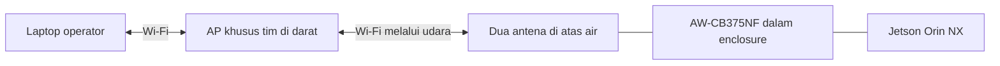

# Riset Wi-Fi Jetson Orin NX untuk akses SSH AUV

Tanggal riset: 21 Oktober 2026. Status: rekomendasi desain dan pengadaan; belum ada pengukuran reconnect pada perangkat tim.

## Kebutuhan dan konteks

Pengguna memastikan akses diperlukan di darat atau saat AUV mengapung, dengan antena di atas air. Enclosure berbahan akrilik/plastik dan antena boleh dipasang di luar melalui penetrasi kedap air. Tujuan akses: SSH, membuka/mengedit kode, dan dashboard tanpa membuka enclosure.

[Inventaris proyek 1 Oktober](../plan/04-hasil-pemeriksaan-jetson.md) mencatat Orin NX, Ubuntu 22.04, L4T 36.4.7, kernel 5.15.148-tegra, serta NetworkManager aktif. Ini catatan historis perangkat, bukan pemeriksaan langsung pada sesi riset ini. Identitas carrier fisik, kartu Wi-Fi yang sekarang terpasang, dan driver aktif masih perlu diperiksa.

## Keputusan yang disarankan

Gunakan **AzureWave AW-CB375NF sebagai pilihan awal**, dua antena dual-band eksternal, dan satu access point (AP) khusus tim yang tetap menyala di darat. Jetson dan laptop sama-sama menjadi klien AP tersebut. Jika kartu ini sudah tersedia dan stabil, ukur terlebih dahulu sebelum menggantinya.

Alasannya adalah bukti kompatibilitas, bukan klaim bahwa kartu ini paling cepat reconnect. Daftar komponen NVIDIA mencantumkan AW-CB375NF dengan pengujian fungsional STA, AP, dan IBSS. Pengujian tersebut tidak memberikan angka waktu reconnect. [Daftar komponen NVIDIA](https://developer.download.nvidia.com/assets/embedded/secure/jetson/orin_nx/docs/DA-11534-001_v1.0.pdf). Catatan akses: entri ditemukan melalui indeks pencarian; URL PDF langsung mengembalikan pembatasan akses saat riset.

Tidak ditemukan benchmark terkontrol yang membandingkan reconnect AW-CB375NF, AX200, dan AX210 pada konfigurasi Jetson tim. Tidak ada dasar untuk menjanjikan reconnect tanpa delay atau menyatakan AX210 pasti lebih cepat.

## Perbandingan seri

| Seri | Karakteristik relevan | Keputusan untuk proyek |
| --- | --- | --- |
| **AzureWave AW-CB375NF** | Realtek RTL8822CE, Wi-Fi 5 dual-band, dua jalur antena; vendor menyebut dukungan Orin NX | Pilihan awal dengan bukti kompatibilitas paling langsung; waktu reconnect tetap harus diukur |
| **Intel AX200NGW** | Wi-Fi 6, 2.4/5 GHz, PCIe untuk Wi-Fi; dukungan upstream Linux mulai 5.1 | Alternatif bila lebih mudah diperoleh dan driver pada image tim sudah tervalidasi |
| **Intel AX210NGW** | Wi-Fi 6E, 2.4/5/6 GHz, PCIe untuk Wi-Fi; dukungan upstream mulai 5.10 | Kandidat pembanding jika membutuhkan kapasitas Wi-Fi 6; dukungan 6 GHz tidak diperlukan untuk SSH ini |

Sumber: [Waveshare AW-CB375NF](https://www.waveshare.com/wiki/Wireless-AW-CB375NF), [perbandingan resmi AX200/AX210](https://www.intel.com/content/www/us/en/products/compare.html?productIds=204836%2C189347), dan [dukungan Linux Intel](https://www.intel.com/content/www/us/en/support/articles/000005511/wireless.html). Halaman Waveshare tersedia melalui indeks pencarian tetapi akses langsung mengembalikan HTTP 403 saat riset.

Kernel 5.15 memenuhi minimum upstream AX200/AX210, tetapi belum membuktikan modul driver dan firmware tersedia pada image Jetson. Staf NVIDIA menjelaskan bahwa konfigurasi Intel yang dibutuhkan tidak aktif secara default pada konfigurasi JetPack 6 yang dibahas dalam [diskusi dukungan Orin NX](https://forums.developer.nvidia.com/t/orin-nx-8g-rt-interl-ax210/329477). Periksa image tim sebelum membeli berdasarkan angka kernel saja.

**Hindari AX201/AX211 untuk slot PCIe Wi-Fi Jetson biasa:** keduanya memakai CNVio2 yang memerlukan platform pendukung; bentuk slot yang mirip tidak cukup. [Panduan Intel](https://community.intel.com/t5/Wireless/Differences-between-Intel-AX211-vs-AX210-WiFi-6E-Bluetooth-v5-2/td-p/1319502/page/2?profile.language=de), [spesifikasi AX211](https://www.intel.com/content/www/us/en/products/sku/204837/intel-wifi-6e-ax211-gig/specifications.html).

Wi-Fi 7 BE200 tidak menjadi prioritas: Intel mencantumkan minimum kernel 6.5, sedangkan inventaris tim mencatat 5.15. Mengganti kernel hanya demi kartu Wi-Fi menambah pekerjaan integrasi tanpa bukti keuntungan reconnect. [Dukungan Linux Intel](https://www.intel.com/content/www/us/en/support/articles/000005511/wireless.html).

## Topologi akses

AP tidak membutuhkan internet untuk SSH lokal. Matikan client isolation pada jaringan ini agar laptop dan Jetson bisa saling mengakses. AP tetap menyala selama AUV menyelam; saat antena kembali di atas air, Jetson mencoba tersambung ke jaringan yang sama.

Alternatif tanpa router terpisah: Jetson menjadi hotspot tetap dan laptop menjadi klien. Untuk AW-CB375NF, mode AP termasuk dalam daftar pengujian fungsional NVIDIA, tetapi implementasi pada image tim tetap harus diuji. Untuk Intel, dokumentasi iwlwifi menyebut dukungan AP 2.4 GHz dan pembatasan AP 5 GHz; jangan membeli AX210 dengan asumsi dapat membuat hotspot 5/6 GHz. [Dokumentasi Linux Wireless](https://wireless.docs.kernel.org/en/latest/en/users/drivers/iwlwifi.html).

## Apa yang perlu disetel agar pulih cepat

Secara konseptual, waktu pulih terdiri dari deteksi link, penemuan AP, autentikasi/asosiasi, kesiapan alamat IP, dan kesiapan sesi aplikasi. Kecepatan transfer maksimum kartu tidak mengukur seluruh proses ini.

1. Gunakan SSID khusus yang terlihat, profil tersimpan, dan autoconnect aktif. Hindari ketergantungan pada hotspot telepon yang dapat mati atau berubah konfigurasi.
2. Gunakan kanal AP tetap. Untuk 5 GHz, pilih kanal non-DFS yang diizinkan negara operasi; DFS dapat menambahkan masa tunggu AP sekitar satu menit atau lebih dalam kondisi tertentu. Ini bukan penundaan pada setiap reconnect klien. [Penjelasan Cisco](https://www.cisco.com/c/en/us/support/docs/wireless-mobility/80211/213882-radar-detection-in-dynamic-frequency-sel.html).
3. Bandingkan 2.4 GHz lebar 20 MHz dan 5 GHz pada lokasi pengujian. Pilih berdasarkan kehilangan paket dan waktu pulih, bukan asumsi bahwa frekuensi tertinggi selalu terbaik.
4. Untuk satu AP tetap, uji pembatasan band/channel dan penguncian BSSID. NetworkManager menjelaskan bahwa penguncian BSSID menonaktifkan roaming dan background scanning; gunakan hanya jika tidak perlu berpindah AP.
5. Uji Wi-Fi power saving dalam kondisi nonaktif. NetworkManager memakai nilai `802-11-wireless.powersave=2` untuk menonaktifkannya. Ini menambah pemakaian daya dan belum tentu mengatasi masalah driver.
6. Aktifkan percobaan autoconnect berulang. `connection.autoconnect-retries=0` berarti terus mencoba, tetapi tidak menjamin interval percobaan atau waktu reconnect tertentu.
7. Gunakan alamat Jetson tetap. IP statis yang dikelola dengan benar menghilangkan tahap meminta lease DHCP; DHCP reservation hanya menjaga alamat tetap dan masih memakai DHCP. Pastikan alamat statis tidak bertabrakan dengan pool DHCP.
8. Akses SSH melalui IP langsung dan autentikasi kunci. Simpan pekerjaan terminal dalam tmux atau layanan agar tidak bergantung pada hidupnya sesi SSH. Pemulihan Wi-Fi tidak menjamin sesi TCP/VS Code yang sudah terputus otomatis hidup kembali.

Sumber pengaturan: [NetworkManager](https://networkmanager.pages.freedesktop.org/NetworkManager/NetworkManager/nm-settings-nmcli.html). Pengaturan di atas adalah kandidat eksperimen; belum diterapkan ke Jetson.

## Pemasangan enclosure dan daftar belanja

- Satu AW-CB375NF M.2 2230 yang sesuai dengan slot Key E carrier; periksa routing PCIe, ruang mekanik, dan dudukan sekrup pada carrier aktual.
- Dua antena dual-band 2.4/5 GHz untuk kedua jalur RF. Pastikan konektor pigtail cocok dengan konektor kecil pada kartu; jangan menyamakan MHF4 dengan U.FL tanpa pemeriksaan.
- Pigtail koaksial pendek dengan pasangan konektor antena yang cocok, misalnya SMA atau RP-SMA sesuai antena. Pilih komponen penetrasi dan antena yang benar-benar memiliki rating perendaman/tekanan sesuai kedalaman AUV; mur bulkhead SMA biasa sendiri tidak membuktikan kedap air.
- Satu AP dual-band khusus tim di darat, dengan pengaturan kanal manual, keamanan personal tanpa captive portal, dan kemampuan menonaktifkan client isolation.

Letakkan kedua antena agar tetap di atas air saat mengapung, jauh dari penghalang logam dan sumber gangguan sejauh layout memungkinkan. Dua antena pada kartu 2x2 bukan dua koneksi cadangan independen. Penempatan akhir harus diuji saat enclosure tertutup, elektronik aktif, dan orientasi AUV berubah.

## Cara membuktikan kartu yang tepat

Untuk setiap kartu, pertahankan AP, antena, kanal, keamanan, posisi, dan konfigurasi IP yang sama. Catat versi OS/kernel, driver, firmware, serta mode AP atau klien.

Jalankan sedikitnya 50 siklus per skenario: sinyal hilang lalu kembali dengan Jetson tetap menyala, putus Wi-Fi secara administratif lalu sambung kembali, dan AP restart. Ukur boot Jetson secara terpisah. Putus administratif tidak mewakili waktu deteksi hilangnya sinyal secara alami.

Catat empat waktu: sinyal/AP tersedia kembali sebagai titik awal, asosiasi selesai dari log, ping berhasil kembali, dan SSH baru berhasil menjalankan perintah. Keberhasilan ping saja belum membuktikan akses kode siap. Ukur pemulihan VS Code secara terpisah bila itu alat operator.

Laporkan median, persentil 95, maksimum, serta jumlah kegagalan. Ulangi kondisi utama pada enclosure tertutup di darat dan saat mengapung, pada jarak operasional yang disepakati tim. Gunakan log NetworkManager/wpa_supplicant dan kernel untuk membedakan pencarian AP, autentikasi gagal, penundaan IP, dan driver reset. Pengujian dengan thruster harus mengikuti fasilitas dan prosedur uji tim.

Usulan sasaran awal tim: **P95 SSH baru siap dalam 3 detik setelah sinyal kembali**, untuk Jetson dan AP yang tetap menyala, alamat tetap, serta profil jaringan tersimpan. Ini kriteria evaluasi yang boleh disesuaikan setelah pengukuran awal, bukan spesifikasi vendor atau hasil pengujian. Catat kasus melebihi batas sebagai kegagalan sasaran, jangan membuangnya dari statistik.

Keputusan pengadaan akhir mengikuti pengukuran ini. Jika AW-CB375NF memenuhi sasaran, tidak ada bukti kebutuhan menggantinya. Jika gagal, identifikasi tahap yang lambat sebelum membandingkan dengan AX210NGW.
