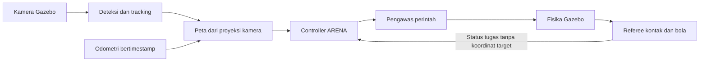

# Hasil ketahanan persepsi dan ARENA autonomous

Tanggal: **25 Oktober 2026, Asia/Jakarta**. Lingkup: menyelesaikan ketahanan deteksi, tracking, proyeksi kamera dan integrasi misi Navigation → flare → blue drum pada **simulator** `/home/rasya/AUV/ros2_ws`.

**Status akhir: perbaikan gate dan pekerjaan penerimaan laporan 17 selesai pada simulator untuk tiga skenario yang diuji.** Build serta 56 tes lulus. Ketiga misi nominal/alternatif mencapai `DONE` dengan referee `COMPLETE`: gate dilewati penuh, tiga bola flare jatuh sesuai urutan, payload menetap dalam blue drum, surface dan stop aktual. Ketiga simulator menutup bersih tanpa pemaksaan kill. Ringkasan hasil serta hash sumber tersedia dalam [verification.json](../ros2_ws/evidence/arena-autonomous/verification.json).

Masalah sebelum jeda: peta mengestimasi gate pada x≈15,033 m, sedangkan gate sebenarnya x=16 m. AUV berhenti pada x≈16,233 m sehingga belakang badan belum lewat sepenuhnya. Proyeksi dengan asumsi tegak lurus menghasilkan estimasi pendek pada pandangan miring, lalu filter landmark mengunci estimasi tersebut. Controller kini menghitung perpotongan dua sinar tiang menggunakan yaw gambar dan orientasi bidang gate kolam (normal world X), tanpa mengetahui posisi bidangnya. Landmark gate baru diterima saat span tiang ≥10% lebar citra. Referee tetap menentukan keberhasilan dari pelintasan seluruh badan, bukan dari tercapainya waypoint.

Bukti sebelumnya yang dipertahankan, tanpa dijalankan ulang pada perbaikan gate ini: 18 skenario kamera, 94 perturbasi, lima uji gangguan, uji fisika bola dan regresi kualifikasi (9,316 s start sampai surface). Perbaikan hanya menyentuh proyeksi/penerimaan landmark gate pada controller ARENA; perintah kualifikasi, detektor piksel, mekanisme fisika dan pengawas tidak diubah. Ini penerimaan pada fixture yang diuji, bukan jaminan untuk semua susunan arena atau kendaraan nyata.

## Acuan dan batas hasil

[Rulebook resmi](https://sauvc.org/rulebook/) diperiksa kembali: edisi terbit **2026 v6.1.0**, diperbarui 27 November 2025. [PR 2027 #25](https://github.com/sauvc/rulebook/pull/25) masih terbuka, sehingga hasil ini tidak dinyatakan sebagai kepatuhan final edisi 2027.

Navigation wajib selesai sebelum tugas lain. AUV harus menghindari orange flare dan tidak menjatuhkan bola flare selama Navigation. Urutan flare disampaikan setelah Navigation; perintah menyentuh flare atau melepas payload tidak membuktikan bola jatuh atau masuk drum. Implementasi mengikuti urutan tersebut. Pinger, reacquisition/pengambilan kembali bola dan sistem skor lomba lengkap tidak termasuk tugas yang diminta.

## Empat bagian yang diimplementasikan

| Bagian | Implementasi |
| --- | --- |
| Ketahanan deteksi | Masker warna/bentuk diperbaiki untuk pencahayaan rendah dan blur ringan; stripe gate dipisahkan dari red drum di latar. Gate satu tiang, citra kosong dan drum terpotong ditolak. Fragmen flare <30 px tidak diberi estimasi jarak. |
| Tracking | ID per kamera, konfirmasi tiga pengamatan, asosiasi kelas/prediksi pusat citra, expiry 0,7 s timestamp gambar. Deteksi yang hilang tidak diterbitkan sebagai prediksi terkini. |
| Kalibrasi/proyeksi simulator | `CameraInfo`, pinhole K, distorsi nol, ekstrinsik kamera depan/bawah dan posisi metrik dari ukuran properti. Pose pada timestamp gambar diinterpolasi sebelum target dipetakan ke world. |
| Kontrol ARENA | Dive dalam starting zone, hindari orange, lewat gate penuh, jalankan urutan flare setelah Navigation, cari blue drum, alignment titik payload, drop, tunggu bukti masuk, surface dan stop. |

Kalibrasi simulator berasal dari geometri pembangkitan kamera, bukan pengukuran DWE. Intrinsik memakai HFOV 1,22173 rad, principal point `(319.5,239.5)` untuk 640×480, piksel persegi. Kamera depan berada di `(0.32,0,0)` badan; kamera bawah di `(0,0,-0.12)` dan menghadap bawah. Model proyeksi ini mengasumsikan badan mendekati datar; pipeline kendaraan fisik memerlukan kalibrasi serta transformasi sikap lengkap yang terukur.

Landmark statis baru memerlukan tiga posisi yang konsisten selain konfirmasi track citra. Pembaruan posisi yang melompat >0,75 m ditolak; jika satu warna terpecah menjadi beberapa komponen, kandidat terdekat dengan landmark dipilih. Ini memperbaiki kasus flare kuning tipis yang sempat menghasilkan jarak terlalu jauh saat urutan `R-Y-B`. Posisi kendaraan dipasangkan dengan timestamp gambar; frame di luar buffer pose/toleransi tidak dipakai untuk memperbarui peta.



Controller tidak menerima layout properti atau berlangganan `/sauvc/arena/physics`. Koordinat pada event referee juga dibuang sebelum status diberikan ke controller. Dimensi kolam/zona dipakai untuk rute pencarian, sedangkan target flare/drum berasal dari kamera. Jika target keluar FOV pada pendekatan terakhir, controller memakai landmark statis dan odometri; ini bukan navigasi visual tanpa lokalisasi.

## Bola fisik dan pembuktian independen

Bola flare dan payload adalah model dinamis dengan collision. Mekanisme latihan menahan bola flare sampai kontak hull–tiang yang nyata, melepas penyangga, lalu memberi dorongan awal kecil; setelah itu gravitasi/collision menggerakkan bola. Tiang masih kaku, dan drag/buoyancy bola di air belum dimodelkan. Pada Fortress, komponen perintah kecepatan perlu dibuang setelah pelepasan agar perintah nol lama tidak membatalkan gerak jatuh.

Payload berdiameter 4 cm dan bermassa contoh 100 g. Titik payload berada **20 cm di depan, 18 cm di bawah** pusat badan agar tidak menutup lensa bawah. Alignment memperhitungkan offset tersebut. Setelah bagian akhir drum terpotong FOV, alignment menyelesaikan pergeseran pendek terhadap pusat hasil kamera yang sudah dipetakan.

Referee terpisah memeriksa seluruh envelope AUV saat lewat gate, kontak orange/flare, urutan bola yang turun >12 cm dari posisi tertahan, lalu payload pertama berada di dalam radius drum dan dekat dasar selama >0,5 s. `DONE` controller, flag release atau kontak saja tidak cukup. Referee menunggu surface dan perintah nol serta posisi stabil selama satu detik sebelum `COMPLETE`. Hasil terminal tidak berubah saat penutupan simulator.

Preset latihan menggagalkan kontak gate, dasar, dinding atau drum oleh hull; ini **lebih ketat** daripada penalti pada rulebook terbit. Keberhasilan yang dicatat adalah rangkaian tugas yang diminta, bukan perhitungan skor kompetisi menyeluruh.

## Bukti pengujian

- **56 tes logika/geometri lulus**, termasuk decode RGB/BGR/stride, deteksi warna/bentuk, clutter red drum di belakang gate, konfirmasi/expiry track, interpolasi yaw pada batas ±π, penolakan landmark melompat, alignment offset payload, penerimaan bola dan hasil terminal. Dua regresi tambahan mencakup koreksi gate miring/arah balik dan memastikan controller terus maju ketika belakang badan belum lewat.
- **18 skenario kamera Gazebo lulus**, mencakup gate depan/balik, jauh/miring, empat warna flare, red/blue drum, posisi offset, satu tiang, citra kosong dan objek terpotong. JSON, raw image, anotasi dan `CameraInfo` dicocokkan melalui timestamp/header.
- **94 pemeriksaan perturbasi frame lulus**: intensitas 55% dan 125%, gain kanal biru 85%, noise ±8, blur horizontal tiga piksel, serta penolakan gate/drum yang dioklusi/dipotong. Ini batas perturbasi yang diuji, bukan jaminan untuk semua pencahayaan/occlusion.
- Pada 18 sampel awal, galat proyeksi terbesar sekitar **0,118 m** pada gate miring. Range pada JSON kamera tetap memakai asumsi tegak lurus. Reproyeksi empat frame gate Gazebo yang sama dengan koreksi bidang menghasilkan galat XY maksimum **0,0204 m**; pada frame gate miring galat XY sekitar **0,0053 m**. Ini pemeriksaan ulang piksel tersimpan, bukan empat run navigasi baru atau akurasi kamera nyata. Bukti: [gate-reprojection.json](../ros2_ws/evidence/arena-autonomous/final/gate-reprojection.json).
- Uji fisika terpisah membuktikan bola tertahan stabil, bola flare jatuh setelah kontak dan payload menetap di dasar drum. Posisi AUV hanya diatur oleh harness pada uji fisika/kamera terpisah, bukan pada misi penuh.
- Regresi kualifikasi `vision`, lane 1, `speed_scale=8` lulus `DONE`: **9,316 s** start sampai surface, **10,438 s** sampai stop pada satu run. Ini bukan median benchmark baru.

Misi penuh dimulai dari starting zone tanpa teleport atau waypoint properti yang disuntikkan ke controller. Fixture alternatif menggeser gate, orange dan ketiga flare; warna drum biru juga ditukar.

| Misi | Layout | Drum biru | Urutan | Hasil final |
| --- | --- | --- | --- | --- |
| Nominal | 0 | 1 | B-R-Y | [Lulus COMPLETE](../ros2_ws/evidence/arena-autonomous/final/nominal-host.json); galat pusat payload 2,36 cm |
| Alternatif yang gagal sebelum jeda | 1 | 3 | Y-B-R | [Lulus COMPLETE](../ros2_ws/evidence/arena-autonomous/final/alternate-host.json); galat pusat payload 2,47 cm |
| Regresi fragmen flare | 1 | 4 | R-Y-B | [Lulus COMPLETE](../ros2_ws/evidence/arena-autonomous/final/blue-four-host.json); galat pusat payload 2,36 cm |

Lima skenario gangguan kamera, perintah, odometri, kontak dan clock membuktikan `ABORT`, perintah nol dan posisi diam. Kehilangan perintah ditangani pengawas independen dengan timeout 0,5 s; data wajib macet ditangani dalam 2 s wall clock. Pengujian kamera terpisah juga memastikan JSON lama serta gambar anotasi dibersihkan ketika kamera berhenti. Alat uji menutup server melalui API sebelum cleanup untuk menghindari hang SIGINT Gazebo yang ditemukan pada salah satu percobaan awal.

Ringkasan akhir, hash 35 file sumber/alat uji dan tautan bukti telah difinalisasi dalam [verification.json](../ros2_ws/evidence/arena-autonomous/verification.json). Log build ada pada [final/build.log](../ros2_ws/evidence/arena-autonomous/final/build.log). Bukti lokal berada di `ros2_ws/evidence/`, diabaikan Git; kode dan alat uji disimpan dalam repositori. Percobaan gagal awal tetap disimpan agar tidak tercampur dengan hasil penerimaan akhir.

Uji penerimaan dijalankan pada host dengan ROS domain dan Gazebo partition terpisah karena sandbox menolak socket UDP lokal DDS/Gazebo. Percobaan sandbox yang gagal membuka transport (`final/alternate.json`) bukan kegagalan navigasi dan tidak termasuk tiga run penerimaan di atas. Saat dijalankan dari terminal lokal biasa, gunakan wrapper workspace seperti perintah berikut.

## Menjalankan dan status

```bash
cd /home/rasya/AUV/ros2_ws
bash tools/ros.sh build --symlink-install
bash tools/ros.sh launch sauvc_sim arena.launch.py arena:=finals autonomous:=true flare_order:=B-R-Y
```

Status: `/sauvc/arena/state`. Hasil independen: `/sauvc/arena/result`. Gambar inspeksi: `/sauvc/perception/front/image_annotated` dan `/sauvc/perception/bottom/image_annotated`. Perintah pengulangan uji ada dalam [README workspace](../ros2_ws/README.md).

Seluruh hasil merupakan simulasi dengan gerak ideal dan odometri ground truth. Kalibrasi DWE fisik, kolam nyata, air keruh/refleksi berat, dinamika thruster, pinger dan pengambilan kembali payload belum divalidasi. GUI/rqt untuk misi ARENA penuh belum diperiksa secara langsung; pengujian runtime dilakukan headless dengan kamera rendering aktif.


Pembaruan 25 Oktober 2026: rincian skor attempt dan rancangan servo payload ditambahkan pada [laporan 19](19-penilaian-arena-dan-rancangan-servo.md). Misi penuh baru, uji mekanisme bola dan putus perintah lulus; poin pinger/reacquisition belum mempunyai bukti fisik runtime. Keterangan skor yang belum lengkap di laporan ini merupakan snapshot sebelum pembaruan tersebut.
