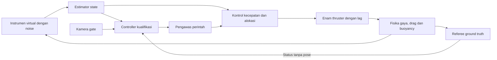

# Kualifikasi dengan gaya thruster dan estimasi sensor

Tanggal: **25 Oktober 2026, Asia/Jakarta**. Lingkup: dua kekurangan pada sesi kualifikasi—model thruster/hidrodinamika dan penggantian umpan balik ground truth dengan estimasi sensor. Semua implementasi dan pengujian berada di `/home/rasya/AUV/ros2_ws`; tidak menjalankan hardware atau MAVLink.

**Status: kedua poin selesai pada simulator.** Build final, **67 tes**, empat misi kualifikasi dinamis, tujuh pemeriksaan karakterisasi gaya, lima skenario gangguan dan satu regresi model ideal lulus. Semua run penerimaan terakhir menutup bersih. Ringkasan dan hash sumber: [verification.json](../ros2_ws/evidence/qualification-dynamics/verification.json).

## Model gerak

Model `dynamic` mengaktifkan gravitasi dan menghapus plugin `VelocityControl`. Plugin native `VehicleDynamics` hanya menambahkan gaya/momen ke solver Gazebo, tanpa mengatur pose atau kecepatan langsung. Empat thruster horizontal dan dua vertikal mempunyai arah/posisi tersendiri; alokasi wrench mengendalikan surge, sway, heave dan yaw. Roll/pitch ditahan secara pasif oleh pusat apung serta damping.

Model gaya thruster: `F_target = F_max*u*abs(u)`, `u` dalam −1…1, dengan respons orde satu `tau=0,15 s`. Batas contoh ±20 N per thruster horizontal dan ±40 N per thruster vertikal. Pengendali kecepatan PI memakai state terestimasi, kompensasi drag/daya apung, pembatasan alokasi dan anti-windup. Integral pada target kecepatan nol dihapus agar thrust sisa tidak menarik kendaraan balik setelah pengereman. Perlambatan aktif memakai thrust terbalik; setelah disarm, drag serta buoyancy tetap bekerja.

Drag translasi/rotasi: `F_drag = -D*v - Q*v*abs(v)`. Buoyancy: `B = rho*g*V_submerged`; volume terendam menurun dekat permukaan, dengan momen dari offset pusat apung. Massa awal 20 kg, volume efektif 20,5 L, air tawar 1000 kg/m³, `g=9,81 m/s²`, pusat apung 3 cm di atas pusat massa. Collision box tetap 60×40×20 cm; volume efektif lebih kecil karena merepresentasikan frame yang sebagian tergenang. Preset sedikit positif buoyancy sehingga kendaraan mengapung ketika thrust nol.

Seluruh koefisien ada di [dynamics.yaml](../ros2_ws/src/sauvc_sim/config/dynamics.yaml). Ini model engineering dengan drag diagonal dan pendekatan waterline untuk badan hampir datar, bukan CFD, added-mass/Coriolis penuh atau kalibrasi kendaraan asli. Arus pada uji ini nol. API gaya mengikuti [Gazebo Fortress Link](https://gazebosim.org/api/sim/6/classignition_1_1gazebo_1_1Link.html); prinsip displacement dijelaskan dalam [API Buoyancy Fortress](https://gazebosim.org/api/sim/6/classignition_1_1gazebo_1_1systems_1_1Buoyancy.html). Plugin gaya yang dipakai adalah implementasi lokal.

## Instrumen dan estimator

Sensor virtual dibangkitkan di dalam simulator dari keadaan fisika, lalu diberi noise/bias. Paket `/sauvc/sensors` tidak memuat posisi, yaw, quaternion orientasi atau odometri jawaban. Estimator hanya berlangganan paket ini.

| Instrumen | Pengukuran dan asumsi contoh |
| --- | --- |
| Gyro | Body FLU rad/s, noise 0,0008 rad/s, bias yaw 0,001 rad/s |
| Accelerometer | Specific force body, noise 0,02 m/s²; koreksi roll/pitch saat hampir diam |
| Magnetometer | µT, medan world `(20,0,-45)`, noise 0,05 µT; koreksi heading dengan kompensasi tilt |
| Tekanan | `p0 + rho*g*depth`, `p0=101325 Pa`, bias 10 Pa, noise 20 Pa |
| DVL | Kecepatan bottom-track body FLU, noise 0,003 m/s, bias `(0,001;-0,001;0,0005)` m/s |

IMU/magnetometer nominal 100 Hz; tekanan dan DVL nominal 20 Hz, dengan timestamp simulasi. Estimator mengintegrasikan gyro dan mengoreksi yaw dengan magnetometer, memprediksi perpindahan dari DVL memakai orientasi terestimasi, lalu mengoreksi kedalaman dengan tekanan. Pose awal XY memakai prior garis deployment yang diketahui; heading dan kedalaman awal berasal dari instrumen. Tidak ada inisialisasi pose dari `/sauvc/odom`.

`/sauvc/state/odom` memuat hasil estimasi dan covariance diagnostik; ini dead reckoning/AHRS komplementer, bukan EKF terkalibrasi atau lokalisasi global bebas drift. Sensor yang kedaluwarsa >0,25 s sim, aliran paket macet >0,3 s wall clock, atau data di luar rentang instrumen membuat state invalid. Tidak ada fallback ground truth ketika instrumen hilang. Semua sensor di sini virtual; ini bukan klaim bahwa perangkat DVL/IMU/depth sensor fisik telah tersedia atau tervalidasi.



Controller dan pengawas membaca `/sauvc/state/odom`, bukan `/sauvc/odom`. Pada mode dinamis, `/sauvc/qualification/status` hanya berisi phase/reason/passed; laporan rinci beserta event pose tetap di `/sauvc/qualification/result` untuk logger. Controller menentukan pelintasan sendiri dari bidang gate yang diamati kamera dan state estimasi, dengan margin lewat 0,6 m; tidak memakai event `FULL_OUTBOUND`/flag `qualification_passed` ground truth untuk beralih fase. Referee boleh menggagalkan pelanggaran dan mengesahkan penghentian aktual.

## Surface dan stop fisik

Setelah pelintasan balik terestimasi, controller mengerem dan naik. Saat mencapai ambang surface, `STOP` mengirim target kecepatan nol dan propulsion mengunci disarm, sehingga enam target thrust menjadi nol. Thrust aktual meluruh sesuai tau, kemudian body mengapung ke waterline. Referee memerlukan hull benar-benar menyentuh/melewati permukaan dan posisi serta perintah nol stabil satu detik; stop tidak dipaksakan dengan men-set velocity nol.

Jam lintasan dinamis dimulai saat `DIVE` diaktifkan, bukan gerakan apung pasif saat preflight. Guard mempertahankan timeout perintah 0,5 s; plant juga mempunyai watchdog aktuator 0,5 s wall clock. Pada putus instrumen, estimator invalid dan propulsion mematikan thrust; preset positif buoyancy membawa kendaraan mengapung. Pada controller dibekukan tetapi state masih sehat, guard meminta kecepatan nol sehingga loop propulsion mengerem/hover sampai stack dihentikan.

## Bukti penerimaan

Build final dan tes logika/geometri tersedia pada `evidence/qualification-dynamics/build-final.log` dan `unit-tests.log`. SDF dinamis lulus `ign sdf -k`. Pemeriksaan mencakup alokasi gaya dan batasnya, reverse braking, keseimbangan Archimedes, dissipasi drag, tekanan/magnetic heading/DVL dead reckoning, input invalid/dropout, transisi sensor-only, dan surface/stop fisik.

Uji karakterisasi nyata di Gazebo (tanpa teleport): **tujuh pemeriksaan lulus**—akselerasi bertahap, tracking kecepatan, thrust balik saat pengereman, berhenti aktif, perlambatan drag pasif, pengapungan tanpa daya dan seluruh thrust nol. Bukti: [characterization.json](../ros2_ws/evidence/qualification-dynamics/characterization.json).

Misi penuh diuji pada kedua jalur, posisi/heading awal bergeser ±0,2 m / ±10°, serta default `vehicle_model=auto`. Pemeriksa independen memastikan dua pelintasan penuh, U-turn, tanpa benturan, surface dan stop. Alat uji juga memeriksa subscription ROS: controller/estimator/propulsion/guard tidak berlangganan odometri ground truth; run default akhir memastikan controller tidak berlangganan laporan referee yang memuat pose. Galat state dihitung oleh harness terhadap ground truth yang diinterpolasi pada timestamp sama, tanpa mengirim koreksi tersebut ke estimator.

| Run penerimaan | Start–surface | Start–stop |
| --- | --- | --- |
| [Default auto, jalur 1](../ros2_ws/evidence/qualification-dynamics/auto-final.json) | 31,154 s | 35,336 s |
| [Dinamis, jalur 2](../ros2_ws/evidence/qualification-dynamics/lane2-final.json) | 30,646 s | 34,896 s |
| [Offset +0,2 m / +10°](../ros2_ws/evidence/qualification-dynamics/offset-plus-accepted.json) | 32,270 s | 36,962 s |
| [Offset −0,2 m / −10°](../ros2_ws/evidence/qualification-dynamics/offset-minus-final.json) | 32,164 s | 36,480 s |

Keempatnya mencapai `COMPLETE`, perintah nol, thrust aktual <0,05 N pada semua kanal dan posisi fisik stasioner. Pemeriksaan isolasi subscription juga lulus pada keempat run. Galat maksimum seluruh sampel keempat run: **XY 0,0975 m**, **kedalaman 0,00984 m**, **heading 0,493°**. Ambang penerimaan alat uji adalah 0,2 m / 0,03 m / 0,03 rad; angka maksimum terukur bukan jaminan hardware atau semua kondisi laut. Seed noise 42 dan arus nol digunakan pada uji ini.

Lima uji gangguan dinamis mencakup tekanan, IMU, DVL, aktuator dan controller SIGSTOP. `passed` pada gangguan berarti penghentian aman terverifikasi; `mission_passed` tetap false. Setelah disarm, alat uji menunggu pengapungan/perlambatan fisik sebelum memeriksa stasioner; tidak mem-pause fisika untuk memperoleh hasil berhenti. Pause hanya dilakukan setelah penilaian, sebelum stop server, agar aliran sensor/bridge selesai lebih bersih saat teardown. Percobaan awal yang gagal cleanup tetap disimpan.

Angka akhir per run, galat state, hash sumber dan daftar bukti berada di [verification.json](../ros2_ws/evidence/qualification-dynamics/verification.json). Bukti lokal diabaikan Git. Angka ideal median 8,806 s pada laporan 15 adalah baseline lama; tidak dibandingkan sebagai kemampuan fisik preset ini. Perubahan ini tidak menetapkan kecepatan maksimum global atau kesiapan lomba perangkat nyata.

Regresi ideal terbaru juga lulus: start–surface 8,840 s, start–stop 9,928 s pada satu run ([bukti](../ros2_ws/evidence/qualification-dynamics/ideal-regression.json)). Transisi surface diperbaiki agar menerbitkan heave, bukan yaw, dan diberi tes regresi. Pembanding ini tetap memakai model ideal serta ground truth yang diberi label eksplisit. Dua percobaan awal menyelesaikan kontrol tetapi gagal cleanup renderer/bridge; bukti gagal tersebut dipertahankan, dan run penerimaan di atas memakai pause setelah penilaian sebelum stop server.

## Menjalankan

```bash
cd /home/rasya/AUV/ros2_ws
bash tools/ros.sh build --symlink-install
# Default auto: dynamic untuk autonomous qualification vision
bash tools/ros.sh launch sauvc_sim arena.launch.py autonomous:=true
# Pilih eksplisit dan jalur kedua
bash tools/ros.sh launch sauvc_sim arena.launch.py autonomous:=true vehicle_model:=dynamic lane:=2
# Pembanding lama
bash tools/ros.sh launch sauvc_sim arena.launch.py autonomous:=true vehicle_model:=ideal
```

ARENA, latihan manual default dan mode `odom` tetap ideal. `vehicle_model:=dynamic` saat ini khusus qualification vision; manual dynamic tersedia untuk karakterisasi gaya. Belum ada kalibrasi gaya/volume/drag/noise pada AUV fisik, pengujian sensor DWE/kolam nyata, DVL fisik, integrasi ArduSub, gelombang atau validasi GUI dinamis. Koefisien harus diganti hasil pengukuran sebelum dijadikan dasar tuning hardware.

## Pembaruan U-turn lebih dekat

Setelah baseline di atas, jarak tambahan dinamis sebelum U-turn dipangkas 1,8 → 1,0 m, dengan perintah maju nol saat ambang tercapai. **68 tes dan empat misi penuh lulus**; dua jalur normal mencatat start–surface 28,486 / 28,706 s. Rincian variasi offset dan perbandingan terhadap baseline berada pada [laporan 15](15-hasil-kualifikasi-autonomous.md#pembaruan-jarak-u-turn--25-oktober-2026) dan [comparison.json](../ros2_ws/evidence/qualification-turn-short/comparison.json). Angka tabel sebelumnya tetap snapshot sebelum perubahan jarak.

Pembaruan lanjutan: jarak tambahan dinamis kini **0,6 m**, dengan 68 tes dan empat misi penuh lulus. Jarak pusat badan terjauh setelah gate sekitar 1,6 m. Waktu dan batas hasil dicatat pada [laporan 15](15-hasil-kualifikasi-autonomous.md#pemangkasan-lanjutan-u-turn--06-m); bukti tersimpan terpisah pada [comparison.json](../ros2_ws/evidence/qualification-turn-060/comparison.json). Angka 1,0 m di atas adalah snapshot sebelumnya.
