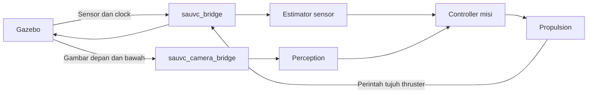

# 43 — Isolasi bridge kamera dan sensor

Tanggal: 1 November 2026. Acuan simulasi: SAUVC 2027.3.2.

## Solusi yang diterapkan

Bridge kamera dipisahkan dari bridge sensor/kendali. Default `bridge_layout:=isolated` menjalankan dua proses `parameter_bridge`: `sauvc_bridge` memuat clock, sensor, odometri, kontak, akustik, telemetri dan perintah aktuator; `sauvc_camera_bridge` hanya memuat gambar depan/bawah. `bridge_layout:=single` mempertahankan susunan lama untuk pembandingan.



Pemetaan topik, arah bridge, QoS, model fisika, pengendali, estimator dan batas timeout dipertahankan. `bridge_layout.py` membagi konfigurasi yang sama ke YAML sementara per proses. Pemeriksa mencatat publisher serta QoS aktual dan menolak duplikasi publisher clock/sensor/kamera. Kontrak unit memastikan setiap mapping tetap ada tepat sekali, kedua kamera dipindahkan, dan topik kendali tetap di bridge utama.

## Cara lain yang diperiksa

Subscriber raw-image RELIABLE yang sudah menerima gambar dihentikan tiga detik, pada susunan tunggal dan terpisah. Keduanya menyelesaikan misi tanpa stale sensor. Jadi dugaan subscriber gambar lambat menyebabkan backpressure DDS **tidak tereproduksi pada kondisi uji ini**. Itu tidak digunakan sebagai kesimpulan penyebab insiden lama.

Jeda proses yang memuat kamera diuji terpisah dengan SIGSTOP/SIGCONT setelah DIVE + 5 detik. Pada susunan tunggal, proses tersebut juga memuat sensor/clock; pada susunan terpisah, hanya `sauvc_camera_bridge` yang dihentikan. Ini membuktikan pembatasan dampak gangguan proses. Ini bukan reproduksi bug rendering/DDS tertentu.

## Hasil simulator

Build dan 160 tes unit lulus. Enam percobaan A/B memakai source yang dibekukan dengan override layout eksplisit. Setelah A/B, hanya default launch dan penguatan assertion unit berubah; empat penerimaan berikutnya menghilangkan override untuk memeriksa default aktual. Seluruh source/hash per tahap disimpan. Dibanding snapshot pengumpulan laporan 42, file model gaya, konfigurasi, controller, estimator dan guard tetap identik.

| Uji | Hasil yang diamati | Umur sensor maks. di window diagnosis |
| --- | --- | --- |
| Tunggal, proses pemuat kamera jeda 1 s | Abort stale_sensors; thruster nol | 1002.65 ms |
| Terpisah, proses kamera jeda 1 s | Misi selesai | 16.37 ms |
| Terpisah, proses kamera jeda 3 s | Abort stale_camera; thruster nol | 11.40 ms |
| Terpisah, bridge sensor jeda 1 s | Abort stale_sensors; thruster nol | 1000.02 ms |
| Tunggal, subscriber raw-image berhenti 3 s | Misi selesai | 25.06 ms |
| Terpisah, subscriber raw-image berhenti 3 s | Misi selesai | 18.83 ms |
| Default baru, kualifikasi GUI + dua POV | Misi selesai | 24.08 ms |
| Default baru, kualifikasi headless | Misi selesai | 20.39 ms |
| Default baru, ARENA blue drum dinamis | Misi selesai | 18.47 ms |
| Default baru, hold 180 s, seed 91, arus lateral 0,02 m/s | Misi/hold selesai | 17.23 ms |

Sepuluh eksperimen diterima: tujuh misi selesai dan tiga abort yang sesuai gangguan. Bridge kamera yang berhenti satu detik memberi jeda status kamera depan sekitar 1,05 s, sementara umur sensor di window gangguan tetap maksimum 16,37 ms, terhadap batas 300 ms. Jeda kamera tiga detik tetap memicu pengaman kamera. Mematikan sementara bridge sensor tetap memicu pengaman sensor. Label `no_stale_sensor_event` pada kasus kamera tiga detik hanya menyatakan sensor navigasi tetap sehat; kamera memang gagal dan misi abort.

Pada keempat penerimaan default, clock dan sensor masing-masing mempunyai tepat satu publisher `sauvc_bridge`; raw-image depan mempunyai tepat satu publisher `sauvc_camera_bridge`. `bridge_layout: null` pada laporan pemeriksa berarti override tidak diberikan, bukan layout tidak diperiksa: graph publisher aktual diverifikasi. GUI menampilkan Gazebo, POV depan dengan gate terdeteksi, dan POV bawah; keduanya memiliki subscriber aktif. [Screenshot](../ros2_ws/evidence/bridge-isolation-2027/acceptance/isolated-gui91-desktop.png).

ARENA blue drum menyelesaikan Navigation, kontak/fall ketiga flare B–R–Y, payload fisik masuk blue drum, Surfacing Square dan stop. Skor simulator **210,18538**, thrust–surface **227,154 s**, bonus Square +20, penalti 0. Referee dan pemeriksaan sensor-only/tujuh thruster lulus. Pinger/pickup tidak diulang pada revisi ini.

Regresi memakai kondisi persis dari kegagalan historis: seed 91, current `[0; 0,02; 0]`, prior nol dan cahaya 100%. Hold aktif 179,996 s mencatat drift fisik maksimum **2,09 cm**, perubahan kedalaman 0,624 cm dan gap sampel maksimum 34 ms. Sensor sehat melewati sim 229,61 s, lokasi waktu gangguan lama. Injeksi stop di akhir hold tetap menghasilkan disarm dan gaya thruster nol. Pada laporan hold, `thrusters_zero` awal dapat bernilai false karena kontrol hold masih aktif; penerimaan stop memakai `abort_thrusters_zero` setelah injeksi. Parent penguji hold exit 0. Ini satu pengulangan kondisi lama, belum pembuktian keandalan statistik.

## Batas diagnosis dan shutdown

Ukuran maksimum misi dibatasi thrust pertama sampai event STOPPED/FAILED; pada regresi hold, batas akhirnya adalah akhir window hold. Probe tetap hidup selama shutdown sehingga dapat merekam sensor stale setelah bridge/physics berhenti; puncak seluruh capture termasuk shutdown juga disimpan terpisah di JSON, tidak dibuang. Window diagnosis gangguan tetap mencakup stop–resume proses.

Rekaman historis ditinjau ulang dengan batas waktu hold. Ada **296 paket stale_sensors pada sim 229,61 s**, masih di dalam hold yang berakhir 246,058 s; gangguan lama tidak dapat dijelaskan hanya sebagai artefak shutdown. Bukti lama tetap tidak membedakan produsen, transport native atau bridge secara unik. Isolasi sekarang membatasi dampak proses kamera; ini belum membuktikan pemicu historis atau mencegah jeda produsen/host secara global.

Kesepuluh pemeriksa mencatat shutdown Gazebo bersih, thruster akhir nol, serta dua observer masing-masing exit 0. Grup RQt memerlukan fallback SIGKILL yang direkam. Tool session induk rangkaian penerimaan dilaporkan exit 143 sesudah tiga laporan dan summary lengkap tersimpan; penyebab terminasi induk tersebut tidak ditetapkan. Status ini dicatat terpisah dari exit checker, Gazebo dan probe; tidak diklaim seluruh lapisan parent keluar normal. Regresi hold berikutnya exit 0 dan audit PID tercatat mengonfirmasi proses uji sudah berhenti.

## Bukti dan pengulangan

Ringkasan dengan hash source, laporan dan raw capture: [verification.json](../ros2_ws/evidence/bridge-isolation-2027/verification.json). Detail pembanding: [A/B summary](../ros2_ws/evidence/bridge-isolation-2027/ab/summary.json). Penerimaan default: [acceptance summary](../ros2_ws/evidence/bridge-isolation-2027/acceptance/summary.json). Regresi [hold summary](../ros2_ws/evidence/bridge-isolation-2027/hold/summary.json) dan [audit PID](../ros2_ws/evidence/bridge-isolation-2027/pid-audit.json). [160 tes unit](../ros2_ws/evidence/bridge-isolation-2027/unit-tests.log) dan [build](../ros2_ws/evidence/bridge-isolation-2027/build.log).

Perintah running biasa otomatis menggunakan isolasi. Pembanding eksplisit:

```bash
cd /home/rasya/AUV/ros2_ws
bash tools/ros.sh launch sauvc_sim arena.launch.py autonomous:=true bridge_layout:=single
# Hentikan run itu sebelum menjalankan pembanding berikut:
bash tools/ros.sh launch sauvc_sim arena.launch.py autonomous:=true bridge_layout:=isolated
```

Untuk mengulang matriks, gunakan folder bukti baru dan jalankan serial; domain 98/partition pengujian harus bebas. Artefak lama tidak ditimpa:

```bash
mkdir -p evidence/bridge-isolation-repeat-001
cp evidence/bridge-isolation-2027/run.py evidence/bridge-isolation-2027/slow_reader.py evidence/bridge-isolation-repeat-001/
bash tools/ros.sh python evidence/bridge-isolation-repeat-001/run.py ab
bash tools/ros.sh python evidence/bridge-isolation-repeat-001/run.py acceptance
bash tools/ros.sh python evidence/bridge-isolation-repeat-001/run.py hold
```

Rangkaian kedua mencakup dua kualifikasi (satu GUI/dua POV) dan satu ARENA dinamis penuh. Rangkaian ketiga mengulang hold 180 s berarus. Setiap rangkaian menulis `summary.json`; kedua probe serta event fault disimpan per kasus. Hasil seluruhnya simulator, bukan validasi AUV fisik.
